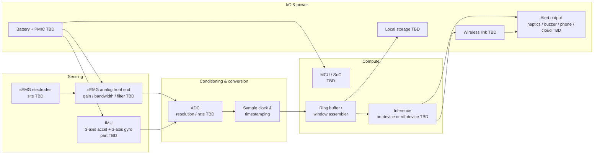
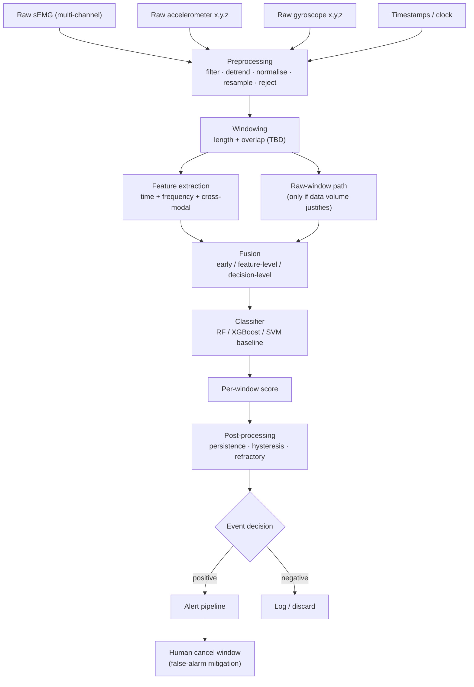
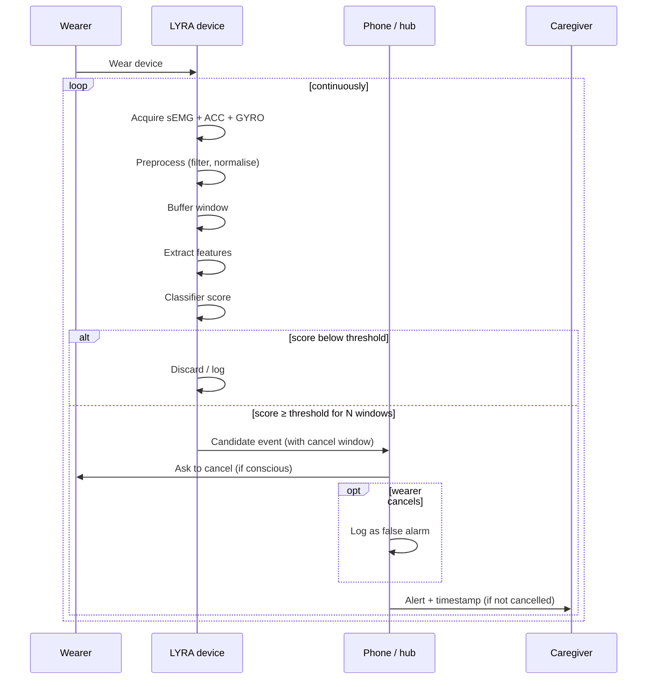

# LYRA — Master Context Document

| Field | Value |
|---|---|
| **Project name** | LYRA |
| **Document purpose** | Central context, source of truth, and onboarding document for LYRA. Written so that developers, researchers, clinicians, and AI coding assistants can understand the project, its evidence base, its decisions, and its open questions without re-deriving the background. |
| **Last updated** | 2026-11-21 |
<<<<<<< HEAD
| **Document version** | 1.2 (Stage 3 complete: verified SeizeIT2 inventory, processed windows, audit) |
| **Project status** | **Stage 3 complete (dataset preparation); Stage 4 not authorized.** Hardware selected (§5.8, not yet built or tested). Python ML foundation and SeizeIT2 preparation pipeline in `mlm/` (§9.7). **No model trained, no performance measured.** Expo companion app with simulated data in `src/`. |
=======
| **Document version** | 1.1 (finalized hardware, four locked Stage 3 decisions, implementation status) |
| **Project status** | **Stage 3 — dataset preparation.** Hardware selected (§5.8, not yet built or tested). Python ML foundation and SeizeIT2 preparation pipeline in `mlm/` (§9.7). **No model trained, no performance measured.** Expo companion app with simulated data in `src/`. |
>>>>>>> 414a2140836e55fed760a18fff6c49fe2bc0082d
| **Repository** | `https://github.com/PrinceJorick/LYRA` (branch `main`) |
| **Owner / maintainer** | Kyle Masilang (git author on record) |

---

## Legend — how claims are labelled

Every non-trivial statement in this document carries one of these markers. Future editors **must** preserve this discipline.

| Marker | Meaning |
|---|---|
| `[DOC]` | Stated by the project's own materials (README, this document's earlier statements, owner-supplied brief). |
| `[VERIFIED]` | Checked against a primary source (paper, official dataset repository, vendor documentation) and cited as `[R#]`. |
| `[PROPOSED]` | A recommendation written in this document. **Not** an adopted project decision. |
| `[UNRESOLVED]` | An open question the team must decide. Do not silently resolve it in code or prose. |
| `[NOT YET SPECIFIED]` | No information exists anywhere in the project. Do not invent a value. |
| `[NOT VERIFIED]` | A claim exists but could not be checked against a primary source (e.g., paywalled full text). |

---

## How to use this document (instructions for future AI assistants)

1. **Read §13 (status) and §14 (decisions) before writing any code.** They tell you what exists and what has actually been agreed.
2. **Never invent hardware.** Every hardware value in this project is currently `[NOT YET SPECIFIED]`. If a task requires a pin, a sampling rate, or a part number, ask the owner or propose options explicitly marked `[PROPOSED]`.
3. **Never invent results.** LYRA has no trained model and no measured performance.
4. **When you complete work, update this file.** Add the change to the changelog (§16), move the item in the status table (§13), and revise any affected decision in §14.
5. **Preserve the naming and concept.** LYRA is a wearable sEMG + IMU system for detecting *possible convulsive seizure events*. Do not rebrand it, and do not expand its claims beyond §12.
6. **Cite, don't assert.** When adding a scientific claim, add the source to §15.D and tag it `[VERIFIED]`.

---

## 1. Executive summary

LYRA is an early-stage research project to build a **wearable, non-invasive seizure-event detection system** that combines **surface electromyography (sEMG)** with **inertial measurement (IMU: 3-axis accelerometer + 3-axis gyroscope)**.

The premise is that a convulsive seizure produces two independent, simultaneously observable signatures:

- **sEMG:** abnormal, sustained or rhythmic *muscle activation* — the electrical correlate of tonic stiffening and clonic jerking.
- **IMU:** the *mechanical* result of that activation — repetitive limb movement, postural collapse, and changes in orientation and angular velocity.

Neither signal alone is sufficient in everyday life. Movement sensors fire on sport, housework, transport, and sleep; sEMG fires on any voluntary contraction. Requiring *both* to agree is the project's core hypothesis for reducing false alarms while retaining sensitivity `[PROPOSED]`.

**What exists today:** a repository containing a one-line `README.md` and this document. There is no code, no hardware, no dataset copy, and no model. The project is an idea with a literature base, not a prototype.

**What is decided today:** the project name, the modality pairing (sEMG + IMU), the framing as *detection of possible events* (not prediction, not diagnosis), and a documentation policy of explicit uncertainty (`[DOC]`).

**What is researched today:** the evidence base is assembled and summarised in §7. The most important finding is quantitative and constrains the project: the largest open wearable dataset, SeizeIT2, contains **55 focal-to-bilateral tonic-clonic seizures** out of 886 annotated seizures `[VERIFIED: R1, R2]`. That is the *only* substantial pool of open, wearable, convulsive, sEMG-containing events in existence. Any LYRA model must be designed for a dataset with **dozens, not thousands, of positive events**.

**Immediate consequence:** LYRA cannot justify a deep-learning-first approach, cannot claim clinical validity, and cannot be validated on public data alone. The defensible first milestone is a **classical, feature-based, patient-wise-validated baseline on SeizeIT2**, with honest metrics (sensitivity, false alarms per 24 h, detection latency) rather than accuracy.

---

## 2. Project identity and overview

### 2.1 What LYRA is

LYRA is a **proposed wearable system for detecting possible seizure events** from two physiological/movement signal families `[DOC]`:

| Signal | Physical origin | What it reflects |
|---|---|---|
| **sEMG** | Depolarisation of skeletal muscle fibres under the electrodes | Muscle activation: tonic contraction, clonic bursts, artefactual contraction |
| **Accelerometer** | Linear acceleration (including gravity) | Limb/trunk translation, tremor, repetitive movement, posture change |
| **Gyroscope** | Angular velocity | Rotation of the limb/trunk, rhythmic oscillation, orientation change |

The device is intended to be worn continuously by a person with epilepsy, to process signals on-device or on a companion device, and to emit an **alert when a pattern consistent with a convulsive seizure is detected** `[DOC, PROPOSED]`.

### 2.2 Intended users

`[UNRESOLVED]` — no user research or requirement document exists. The following is inferred from the concept and **must be confirmed by the owner**:

| User group | Presumed need | Status |
|---|---|---|
| People with epilepsy who have convulsive seizures | Objective seizure logging; caregiver alerting | `[PROPOSED]` |
| Caregivers / family members | Timely notification, especially at night | `[PROPOSED]` |
| Clinicians / epileptologists | Better seizure counts than diaries | `[PROPOSED]` |
| Researchers | Reproducible open pipeline for wearable sEMG–IMU detection | `[PROPOSED]` |

**Do not assume** a specific market, country, age range, or care setting. Low-resource or home settings are a plausible motivation but are **not** an established project decision.

### 2.3 The problem LYRA addresses

Epilepsy affects roughly 1% of the population, and seizure documentation in routine care depends on patient diaries, which are unreliable `[VERIFIED: R1 — cited within the SeizeIT2 data descriptor]`. Long-term video-EEG is the reference standard but is hospital-bound and expensive `[VERIFIED: R1]`. Wearable devices can record continuously outside hospital, but automated detection of *non-convulsive* seizures remains poor, while convulsive seizures are the events most amenable to movement- and muscle-based detection and the ones linked to injury and SUDEP risk in the literature cited by the dataset authors `[VERIFIED: R1, R12]`.

LYRA's problem statement is therefore narrower than "detect epilepsy": **can a low-cost wearable using sEMG and IMU detect convulsive seizure events in everyday life with high sensitivity and an acceptable false-alarm burden?** `[PROPOSED]`

### 2.4 Concept of operation

1. The wearer puts on the device.
2. The device records sEMG and IMU continuously.
3. Signals are preprocessed and windowed.
4. A classifier scores each window for "possible convulsive seizure".
5. Consecutive positive windows are merged into a candidate event.
6. An alert is raised (local alarm, phone notification, caregiver message — mechanism `[UNRESOLVED]`).

### 2.5 What LYRA is **not**

These boundaries are non-negotiable until evidence says otherwise:

- **Not a diagnostic device.** It does not establish or rule out epilepsy.
- **Not a seizure predictor.** It does not forecast seizures before clinical onset. No forecasting claim is made or supported.
- **Not a treatment or prevention device.** It does not stop, shorten, or prevent seizures.
- **Not a replacement for clinical monitoring or video-EEG.**
- **Not validated.** No sensitivity, specificity, or false-alarm figure exists for LYRA.
- **Not a general seizure detector.** Non-convulsive, absence, and many focal seizures produce no reliable sEMG/IMU signature and are outside the plausible scope `[VERIFIED: R10, R12]`.

### 2.6 Capability maturity

| Capability | Intended | Implemented | In development | Proposed only |
|---|---|---|---|---|
| Wearable sEMG + IMU acquisition | Yes `[DOC]` | No | No | — |
| On-device preprocessing | Yes | No | No | Yes |
| Seizure-event classification | Yes | No | No | Yes |
| Alerting (caregiver) | Yes | No | No | Yes |
| Data pipeline / loaders | Yes | No | No | Yes |
| Model training code | Yes | No | No | Yes |
| Mobile app / dashboard | Unclear `[UNRESOLVED]` | No | No | — |
| Clinical validation | Required before claims | No | No | — |
| Documentation | Yes | Partial (this file) | Yes | — |

**Evidence for "No":** the repository contains only `README.md` (the single line `# LYRA`), an empty `context.md` before this revision, and `.gitignore`. See §15.B.

---

## 3. Problem statement and research foundation

### 3.1 Limitations of current seizure monitoring

| Approach | Strength | Limitation |
|---|---|---|
| Patient diary | Zero cost, universal | Documentation sensitivity below ~50% `[VERIFIED: R1]` |
| Video-EEG (vEEG) | Clinical reference standard | Hospital-bound, costly, days-long, cannot be used in daily life `[VERIFIED: R1, R9]` |
| Scalp EEG wearables | Direct cortical signal | Bulky, stigmatising, artefact-prone outside hospital `[VERIFIED: R1]` |
| Sub-scalp/implanted EEG | Good signal, long-term | Invasive, requires surgery `[VERIFIED: R1]` |
| Movement-only wearables | Cheap, acceptable | Daily activities misclassified as GTCS; blind to non-motor seizures `[VERIFIED: R4, R10]` |
| sEMG-only wearables | Direct muscle activation | Sensitive to voluntary movement; placement-dependent `[PROPOSED — engineering reasoning; R7 validates the sEMG approach itself]` |

### 3.2 Why continuous, wearable monitoring

Seizures are unpredictable and frequently unwitnessed, especially at night. Objective, continuous, home-based recording addresses (a) under-reporting, (b) delayed rescue, and (c) the inability of short in-hospital studies to capture events `[VERIFIED: R1, R11]`. This is the motivation that makes a wearable approach worth pursuing `[PROPOSED]`.

### 3.3 Why the problem is hard

1. **Class imbalance.** Convulsive seizures occupy seconds-to-minutes within days of recording — positive windows are a vanishing fraction of the data `[VERIFIED: R1, R4, R5]`.
2. **Impostor movements.** Brushing teeth, cycling, climbing stairs, shivering, coughing, laughing, and sexual activity generate rhythmic movement and muscle activation `[VERIFIED: R4]`.
3. **Highly variable semiology.** Seizure type, spread, and motor expression differ across and within patients `[VERIFIED: R1, R12]`.
4. **Sensor placement sensitivity.** Signal amplitude depends on electrode-to-muscle geometry; a displaced electrode changes the signal `[VERIFIED: R5]`.
5. **Everyday artefacts.** Perspiration, clothing, posture, and electrode lift create broadband noise.
6. **Clinical ground truth is expensive.** Annotation requires expert review of vEEG + video `[VERIFIED: R1]`.
7. **Rare positives limit model complexity.** With tens of events, deep networks overfit patient identity rather than seizure physiology `[PROPOSED, derived from R1/R5]`.

### 3.4 Sensor roles

#### Surface EMG

- Measures the electrical activity of skeletal muscle underlying the electrodes.
- During a tonic phase, motor-unit firing is sustained and high-amplitude.
- During a clonic phase, bursts recur rhythmically at roughly 1–5 Hz.
- A wearable sEMG channel on a limb muscle is therefore a direct read-out of *motor* seizure expression.
- **Caveat:** sEMG also records every voluntary and postural contraction. It cannot distinguish "seizure" from "lifting a bag" on amplitude alone. Electrode placement over a muscle that is not involved in the seizure yields little signal `[PROPOSED, consistent with R5]`.

#### Accelerometer

- Measures linear acceleration including gravity, hence both movement intensity and static orientation.
- Repetitive clonic movement produces periodic acceleration at the limb.
- Tonic stiffening produces a change in orientation and a period of reduced variance.
- Atonic collapse produces a sharp transient.
- `[VERIFIED: R4, R5]` — accelerometry is a primary signal in published wristband and multi-sensor seizure detectors.

#### Gyroscope

- Measures angular velocity.
- Rotational, thrashing, and cycling-like movements have distinctive angular signatures.
- Gyroscope data is complementary to acceleration: a limb can translate without rotating, and rotate without much translation.
- `[VERIFIED: R4]` — Wang et al. explicitly add the gyroscope to accelerometer + sEMG and report improved performance versus "combinations with fewer signal modalities".

### 3.5 Why combine sEMG and IMU

The two modalities fail in **different** ways:

| Situation | sEMG | IMU | Fused interpretation |
|---|---|---|---|
| Voluntary exercise | High | High, broadband | Muscle + movement both present but not seizure-like |
| Passive transport (car, lift) | Low | High | Movement without muscle activation → not convulsive |
| Tonic stiffening | Sustained high | Low-motion + orientation shift | High muscle + low motion → suspicious |
| Clonic jerking | Rhythmic bursts | Rhythmic acceleration + rotation | Periodic in **both** → strongly suspicious |
| Non-convulsive focal seizure | Low | Low | Invisible — **false negative by design** |

Published evidence supports fusion value:

- Wang et al. report that adding gyroscope and sEMG to accelerometry improved sensitivity and reduced the false-alarm rate relative to fewer-modality combinations `[VERIFIED: R4]`.
- In the SeizeIT2 cohort, fusing behind-the-ear EEG with EMG reduced false positives to 0.4/24 h, and adding accelerometry reduced them to 0.1/24 h while keeping sensitivity at 90.9% `[VERIFIED: R8]`.
- A 2025 review concludes that multimodal devices generally outperform single-parameter devices and that GTCS/FBTCS detection is achievable at high sensitivity with low false-alarm rates, whereas focal seizure detection in ambulatory settings remains suboptimal `[VERIFIED: R12]`.

### 3.6 Caution

**Not every seizure produces detectable muscle or movement patterns.** Absence seizures, many focal aware seizures, and non-motor focal seizures will be missed by any sEMG–IMU system `[VERIFIED: R10, R12]`. This is a structural limitation, not a modelling failure, and must never be presented otherwise.

---

## 4. Target seizure type and detection scope

### 4.1 Is the target defined?

**No.** `[UNRESOLVED]` — neither the repository nor the project brief names a target seizure type. This section explains the options and makes a recommendation that is **not yet adopted**.

### 4.2 Seizure types relevant to a movement/muscle sensor

| Type | Motor expression | Detectable by sEMG? | Detectable by IMU? | Suitability for LYRA |
|---|---|---|---|---|
| **Generalised tonic-clonic (GTCS)** | Bilateral tonic stiffening → rhythmic clonic jerking | Strong (bilateral muscle activation) | Strong (whole-body rhythmic movement) | **Best** — the canonical target of every commercial movement-based detector `[VERIFIED: R3, R7, R10]` |
| **Focal-to-bilateral tonic-clonic (FBTCS)** | Focal onset, then bilateral convulsion | Strong once bilateral | Strong once bilateral | **Best**, but onset detection is delayed until propagation `[VERIFIED: R5]` |
| Focal motor (clonic, tonic, hyperkinetic, automatisms) | Localised or complex movement | Possible if electrode over involved muscle | Possible but often subtle | Hard; high false-alarm risk `[VERIFIED: R9, R12]` |
| Focal non-motor (sensory, cognitive, autonomic) | None | No | No | **Out of scope** |
| Absence / generalised non-motor | None or eyelid flutter | No | No (eyelid myoclonia may be marginal) | **Out of scope** `[VERIFIED: R10]` |
| Myoclonic / atonic / tonic (non-clonic) | Brief jerk / collapse / stiffening | Partial | Partial | Possible future extension `[VERIFIED: R11]` |
| Subclinical / electrographic only | None | No | No | **Out of scope** |

### 4.3 What the evidence says about scope

- Commercial and research devices that pair movement sensors with muscle or autonomic signals target **generalised tonic-clonic seizures** and state explicitly that they do not detect non-convulsive seizures `[VERIFIED: R10, R11]`.
- The strongest published performance figures for wearables are for **GTCS/FBTCS**, not for all seizures `[VERIFIED: R5, R7, R12]`.
- The only large open wearable dataset (SeizeIT2) contains focal epilepsy patients with **55 FBTCS** among 886 seizures `[VERIFIED: R1, R2]` — i.e. convulsive events are ~6% of the annotated events.
- Focal seizure detection from wearables remains difficult: a 192-participant multicenter validation reported sensitivity 0.73 at precision 0.004, improving to precision 0.83 only after human review, at the cost of sensitivity falling to 0.31 `[VERIFIED: R9]`.

### 4.4 Recommendation (explicitly `[PROPOSED]`, not adopted)

> **Narrow LYRA's initial detection scope to generalised tonic-clonic seizures and focal-to-bilateral tonic-clonic seizures, in adults, using a single wearable sensor location. Treat every other seizure type as out of scope for version 1, and state this limitation in every output.**

Rationale:

1. It matches the only signal physics LYRA can reliably observe.
2. It matches every successful commercial precedent.
3. It matches the composition of the only large open dataset.
4. It makes the false-alarm problem tractable, because the target class is visually and mechanically distinct.

### 4.5 Consequences if adopted

| Consequence | Implication |
|---|---|
| Target prevalence in data | ~6% of annotated events in SeizeIT2 `[VERIFIED: R1, R2]` |
| Positive-event budget | ~55 events total, from ~40–45 patients `[PROPOSED estimate from R1]` |
| Model class | Classical, low-capacity, patient-wise validated `[PROPOSED]` |
| Negative class | Must include exercise, transport, sleep, and device-handling artefacts, not just "quiet" |
| Clinical framing | "Possible convulsive seizure detected — seek attention if the person does not recover" |

> **Do not** state that LYRA detects "seizures" without the qualifier "convulsive" / "tonic-clonic".

---

## 5. Hardware and sensor architecture

### 5.1 Status

> **Superseded 2026-11-21:** the hardware is now selected — see §5.8. The table below is kept as the 2026-11-16 record.

**There is no hardware.** No board, module, sensor, electrode, battery, or enclosure is named anywhere in the repository `[DOC: repo inspection, §15.B]`. Consequently:

- Microcontroller / SoC: **`[NOT YET SPECIFIED]`**
- sEMG front end / module: **`[NOT YET SPECIFIED]`**
- Accelerometer part: **`[NOT YET SPECIFIED]`**
- Gyroscope part: **`[NOT YET SPECIFIED]`**
- IMU package (integrated vs discrete): **`[NOT YET SPECIFIED]`**
- Electrode type, count, spacing: **`[NOT YET SPECIFIED]`**
- Electrode placement site(s): **`[NOT YET SPECIFIED]`**
- Sampling rates: **`[NOT YET SPECIFIED]`**
- ADC resolution: **`[NOT YET SPECIFIED]`**
- Communication interfaces (I²C/SPI/UART/BLE): **`[NOT YET SPECIFIED]`**
- Battery chemistry, capacity, runtime: **`[NOT YET SPECIFIED]`**
- Charging method: **`[NOT YET SPECIFIED]`**
- Wireless protocol and range: **`[NOT YET SPECIFIED]`**
- On-board storage: **`[NOT YET SPECIFIED]`**
- Enclosure, strap, size, weight, IP rating: **`[NOT YET SPECIFIED]`**
- Form factor (wrist / arm / chest / thigh): **`[NOT YET SPECIFIED]`**

**This is deliberate, not an omission.** Any value found in a later document supersedes this table and must be tagged with its source.

### 5.2 Intended architecture (logical, hardware-agnostic)

The diagram below shows the **required functional blocks**, not a selected design. Every block marked `TBD` is undecided.



### 5.3 Component rationale (why each block exists)

| Block | Purpose | Why it matters for LYRA | Status |
|---|---|---|---|
| Electrodes | Interface to muscle | Determines signal amplitude, motion artefact, comfort, and skin safety | `[NOT YET SPECIFIED]` |
| Analog front end | Amplify µV–mV differential sEMG, reject common-mode noise | sEMG is small compared with mains and motion artefacts; a poor AFE destroys the signal before digitisation | `[NOT YET SPECIFIED]` |
| IMU | Capture movement and orientation | Second, independent evidence stream to suppress movement-only false alarms | `[NOT YET SPECIFIED]` |
| ADC | Convert analogue sEMG | Resolution and rate set the achievable feature bandwidth | `[NOT YET SPECIFIED]` |
| Clock / sync | Common timebase for sEMG and IMU | Windows must align modalities; drift breaks fusion | `[NOT YET SPECIFIED]` |
| MCU / SoC | Buffering, feature extraction, inference, radio | Sets the ceiling on model complexity and battery life | `[NOT YET SPECIFIED]` |
| Storage | Retain data for offline review | Research requires raw data; clinical use requires an audit trail | `[NOT YET SPECIFIED]` |
| Radio | Send alerts, sync time, offload data | Alert latency and privacy depend on it | `[NOT YET SPECIFIED]` |
| Battery + PMIC | Continuous operation | Runtime is the binding usability constraint for overnight monitoring | `[NOT YET SPECIFIED]` |
| Alert output | Notify wearer/caregiver | The only clinically meaningful output of the system | `[NOT YET SPECIFIED]` |

### 5.4 Electrode configuration and placement

`[UNRESOLVED]` — no configuration has been chosen. The design space:

| Question | Options | Considerations |
|---|---|---|
| Bipolar vs monopolar (referenced) | Bipolar differential is standard for wearable sEMG | Rejects common-mode noise; needs two electrodes per channel |
| Channel count | 1 vs 2 vs more | Wabi et al. achieved their best result with a **two-sensor** setup (right biceps brachii + left tibialis anterior), suggesting low channel counts can suffice `[VERIFIED: R5]` |
| Muscle site | Biceps brachii, deltoid, trapezius, forearm flexors, tibialis anterior, quadriceps | Must be a muscle reliably recruited by a bilateral convulsion; must tolerate 24 h wear |
| Electrode–muscle alignment | Fixed by garment/strap | Misalignment degrades amplitude; needs a donning procedure |
| Skin preparation | Dry vs gel vs hydrogel | Affects impedance stability and comfort |
| Reference electrode | Required for monopolar; not for bipolar | Placement affects common-mode rejection |

**Published placements for reference (do not copy without deciding):**

- SeizeIT2: one EMG channel, left deltoid, two Ag/AgCl cup electrodes, impedance <5 kΩ `[VERIFIED: R1, R2]`.
- Wabi et al.: eight sensors, bilaterally on upper trapezius, anterior deltoid, biceps brachii, and tibialis anterior `[VERIFIED: R5]`.
- Wang et al.: wristband carrying accelerometer, gyroscope, and sEMG `[VERIFIED: R4]`.

### 5.5 Sampling rates and bandwidth — engineering considerations only

No rate has been chosen. The following is basic signal-processing reasoning, not a project decision:

| Signal | Content of interest | Implication |
|---|---|---|
| sEMG | Most power 20–150 Hz; usable content to ~450 Hz in surface recordings | Nyquist requires ≥1 kHz for faithful EMG; 250–500 Hz is a compromise used in wearables |
| Accelerometer | Convulsive oscillation ~1–5 Hz; posture is DC | 25–100 Hz is adequate for rhythm; higher rates help with impact transients |
| Gyroscope | Same oscillation band, plus fast rotations | 25–100 Hz is adequate; saturation range matters more than rate |
| Fusion timestamps | Window-level alignment | Both modalities must share a monotonic clock, or be resampled onto a common grid |

**Important reality check:** SeizeIT2 distributes EMG at **256 Hz** and movement at **25 Hz** `[VERIFIED: R2 — file sidecars]`, even though the recording device sampled at 250 Hz `[VERIFIED: R1]`. A LYRA device sampling sEMG at, say, 1 kHz would produce data that is *not* directly comparable to SeizeIT2 without resampling. This trade-off (model fidelity vs dataset compatibility) is unresolved.

### 5.6 Power, connectivity, wearability

| Requirement | Target | Status |
|---|---|---|
| Continuous runtime | Overnight at minimum; 24 h desirable (SeizeIT2's device achieved ~24 h `[VERIFIED: R1]`; commercial devices claim up to 7 days `[VERIFIED: R10]`) | `[UNRESOLVED]` |
| Charging | Must not require removal during the highest-risk period (sleep) | `[UNRESOLVED]` |
| Wireless range | Must cover the wearer's home if alerts go to a phone/hub | `[UNRESOLVED]` |
| Water resistance | Showering is a daily activity; device may be removed | `[UNRESOLVED]` |
| Weight / bulk | Should not disturb sleep or attract attention | `[UNRESOLVED]` |
| Skin safety | 24/7 electrode contact requires biocompatible materials and a rotation policy | `[UNRESOLVED]` |

### 5.7 Hardware decision checklist (blocking)

Before any firmware work, the owner must answer:

1. Form factor and wear site.
2. Number of sEMG channels and their muscles.
3. Whether the IMU is co-located with the sEMG electrodes or on a separate module.
4. Whether inference runs on-device or on a phone.
5. Minimum runtime and battery budget.
6. Whether raw data is stored for research or only features.

### 5.8 Finalized hardware configuration (2026-11-21)

`[DOC: owner brief, 2026-11-21]`. Selected, **not yet built, bench-tested or validated**.

| Item | Selection |
|---|---|
| Microcontroller | ESP32-S3-DevKitC-1-N8R8 — primary on-device inference |
| sEMG | MyoWare 2.0 Muscle Sensor v2.0.4; `ENV` output is the first processing path, `RAW` kept as a separate research path |
| sEMG `ENV` ADC rate | **50.0 Hz** (locked Decision 3; exact 2:1 against the IMU) |
| MyoWare analog chain (as modelled) | input high-pass 20.8 Hz (1st order) → rectifier → passive envelope low-pass 3.6 Hz (1st order) `[DOC: Decision 2]` |
| IMU | Bosch BMI270, accelerometer + gyroscope, **25 Hz ODR** (50 Hz experimental) |
| Battery / power | Protected 3.7 V 500 mAh LiPo; TI BQ24074 charger/power path; TI TPS63031 regulator; MAX17048 fuel gauge |
| Electrodes | Disposable Ag/AgCl |
| User control | Physical tactile cancellation button |
| Placement | Proximal upper arm, preferably the **deltoid** (sEMG and IMU on the pod) |
| Phone link | BLE: pod = GATT peripheral/server, phone = central/client (draft payloads in `mlm/docs/BLE_PROTOCOL.md`) |
| Inference location | **On the ESP32-S3.** The phone handles pairing, battery, alerts, the cancellation countdown, caregiver workflow, history, observations and reports |

Wi-Fi CSI is a separate research track and not an input to the primary detector.

---

## 6. Machine-learning model

**Status: entirely `[PROPOSED]`.** No model, training script, feature extractor, or dataset loader exists. This section defines the intended pipeline and the reasoning behind each stage so that implementation does not require re-deriving it.

### 6.1 Pipeline overview



### 6.2 A. Data acquisition

Requirements, independent of hardware choice:

| Requirement | Detail | Status |
|---|---|---|
| Continuous sEMG | At least one differential channel, 24 h capable | `[PROPOSED]` |
| 3-axis accelerometer | x, y, z, same timebase | `[PROPOSED]` |
| 3-axis gyroscope | x, y, z, same timebase | `[PROPOSED]` |
| Timestamp synchronisation | Monotonic device clock; drift correction against a host clock at sync points | `[PROPOSED]` |
| Sampling-rate record | Stored in metadata, not hard-coded | `[PROPOSED]` |
| Saturation detection | Flag clipped samples rather than silently using them | `[PROPOSED]` |
| Event annotation | Clinical ground truth with onset and offset, ideally with type and confidence | `[PROPOSED]` |
| Data integrity | Checksums, gap markers, battery/voltage log | `[PROPOSED]` |

**Design rule:** every recording must be self-describing (device ID, firmware version, sampling rates, electrode site, gain, filter settings). Without this, pooled analysis across sessions and devices is impossible.

### 6.3 B. Signal preprocessing

| Step | Purpose | Method options | Risk if skipped | Status |
|---|---|---|---|---|
| Anti-alias / band-pass | Remove DC drift, motion artefact, mains | sEMG: ~20–450 Hz band-pass; notch at 50/60 Hz | Baseline wander dominates RMS | `[PROPOSED]` |
| Notch / comb filter | Remove power-line interference | IIR notch, or spectral interpolation | Periodic 50/60 Hz inflates energy features | `[PROPOSED]` |
| Baseline correction | Remove DC offset from electrodes | High-pass or median subtraction | Amplitude features biased | `[PROPOSED]` |
| Rectification | Prepare for envelope features | Absolute value | — (needed for RMS/MAV/envelope) | `[PROPOSED]` |
| Envelope | Capture tonic/clonic structure | RMS in sliding windows, or low-pass of rectified signal | Raw sEMG is noisy at window level | `[PROPOSED]` |
| Normalisation | Compare across sessions/electrodes | Per-recording robust scaling (median/IQR), or MVC normalisation | Inter-session amplitude shift breaks thresholds | `[PROPOSED]` |
| Resampling | Common grid for fusion | Downsample EMG or upsample IMU | Windows misalign | `[PROPOSED]` |
| Missing-data handling | Device dropouts, flat lines | Gap detection + mask; exclude window if gap > threshold | Silent corruption | `[PROPOSED]` |
| Artefact rejection | Electrode pop, movement saturation | Amplitude/derivative thresholds; flag, don't delete silently | False alarms from artefacts | `[PROPOSED]` |
| IMU orientation | Gravity removal for dynamic acceleration | Low-pass gravity estimate, subtract | Movement intensity conflated with posture | `[PROPOSED]` |

**SeizeIT2-specific preprocessing facts** `[VERIFIED: R1]`: the released EMG/EEG/ECG are at 256 Hz and movement at 25 Hz; the dataset paper's own baseline used 2-second windows with 50% overlap, a 1–25 Hz Butterworth band-pass (for EEG), and discarded segments with RMS outside 13–150 µV. Those choices are specific to behind-the-ear EEG and should **not** be copied blindly for sEMG.

### 6.4 C. Window segmentation

| Parameter | Recommendation | Status |
|---|---|---|
| Window length | 2–5 s for clonic rhythm; consider 5–10 s to capture tonic phase | `[PROPOSED]` — must be tuned |
| Overlap | 50% for training; 50–75% at inference for latency | `[PROPOSED]` |
| Label assignment | Window positive if it overlaps an annotated event by ≥50%, or if its centre lies inside the event | `[UNRESOLVED]` — both conventions change sensitivity |
| Transition handling | Exclude or down-weight windows straddling onset/offset | `[PROPOSED]` |
| Gaps | Discard windows containing a data gap | `[PROPOSED]` |
| Event merging | Merge consecutive positive windows; apply a refractory period | `[PROPOSED]` |

Window length and overlap are **configurable research parameters**, not constants. They must live in a config file and be reported with every result.

### 6.5 D. Feature extraction

#### sEMG features

| Feature | Definition | What it contributes | Caveat |
|---|---|---|---|
| RMS | √(mean of squared samples) | Overall activation level; robust to zero-crossing noise | Sensitive to electrode impedance |
| MAV (Mean Absolute Value) | mean(\|x\|) | Cheap activation proxy; standard in EMG literature | Similar to RMS, less peak-sensitive |
| Waveform length | Σ\|x[n] − x[n−1]\| | Captures frequency + amplitude jointly | Sensitive to high-frequency noise |
| Zero crossings | Count of sign changes | Rough frequency proxy | Noisy without hysteresis threshold |
| Slope sign changes | Count of local slope reversals | Frequency/complexity proxy | Threshold-dependent |
| Signal energy | Σx² | Equivalent to RMS² over a window | Scale-dependent |
| Variance / std | Spread of amplitude | Distinguishes tonic (low variance) from clonic (high variance) | Needs detrending |
| Frequency-domain | Band power, median frequency, spectral entropy | Separates rhythmic clonic bursts from broadband artefacts | Needs sufficient window length |
| Envelope periodicity | Autocorrelation peak in 1–5 Hz band | Direct clonic-rhythm detector | Fails for tonic-only events |

#### Accelerometer / gyroscope features

| Feature | Definition | What it contributes |
|---|---|---|
| Signal magnitude | ‖a‖ = √(ax²+ay²+az²) | Orientation-independent movement intensity |
| Mean / std per axis | First two moments | Posture and variability |
| Signal energy | Σ‖a‖² | Movement intensity over the window |
| Peak acceleration | max ‖a‖ | Detects impact/jerk; also detects bumps and drops |
| Jerk | d‖a‖/dt | Sharpness of movement |
| Angular velocity magnitude | ‖ω‖ | Rotation intensity |
| Angular velocity stats | mean, std, range per axis | Thrashing vs simple translation |
| Dominant frequency | Peak of PSD in 0.5–8 Hz | Clonic rhythm (~1–5 Hz) |
| Spectral band power ratio | Power in 1–5 Hz / total | Rhythm-specificity |
| Periodicity / autocorrelation | Peak autocorrelation in 0.5–5 Hz | Sustained rhythmic movement |
| Orientation change | Angle between window-start and window-end gravity vectors | Tonic postural shift, collapse |
| Motion–muscle coherence | Correlation between sEMG envelope and IMU magnitude | **Cross-modal evidence of the same event** |

**Cross-modal features are the scientific core of LYRA.** A window in which the sEMG envelope and the IMU magnitude oscillate at the same frequency, with the same phase relationship, is far more specific than either alone `[PROPOSED, motivated by R4 and R8]`.

### 6.6 E. Model development

#### Recommended progression (simplest defensible first)

| Stage | Model | Why | When justified |
|---|---|---|---|
| **M0** | Threshold rules on envelope + periodicity | Establishes a floor; exposes artefact behaviour; no training required | Immediately |
| **M1** | Logistic regression on a small feature set | Interpretable, low variance, works with few positives | Immediately |
| **M2** | Random Forest / XGBoost on the full feature set | Handles non-linearity and feature interactions; strong tabular baseline; used in the closest published work `[VERIFIED: R5]` | With ≥40 positive events |
| **M3** | SVM with RBF kernel | Strong small-sample baseline; used by the SeizeIT2 benchmark `[VERIFIED: R1]` | If M2 unstable |
| **M4** | 1D-CNN on raw windows | Learns morphology without hand-crafted features | Only with **thousands** of positive windows and strict patient-wise splits |
| **M5** | CNN + recurrent / transformer | Sequence modelling | **Not justified** by current data volume |

Rationale for restraint: Wabi et al. achieved 100% sensitivity and 0.12 false alarms/24 h with XGBoost on engineered features from a two-sensor setup `[VERIFIED: R5]`. The SeizeIT2 benchmark used an SVM with 42 engineered features `[VERIFIED: R1]`. Nothing in the evidence suggests that LYRA's first model should be deep.

#### Fusion strategies

| Strategy | How it works | Advantages | Disadvantages | Verdict |
|---|---|---|---|---|
| **Early fusion (raw)** | Concatenate channels, feed one model | Model can learn cross-modal interactions | Needs a lot of data; scale differences between µV and g are awkward; less interpretable | Defer |
| **Feature-level fusion** | Concatenate engineered features, one classifier | Simple, data-efficient, interpretable, handles scale via normalisation | Cannot exploit fine temporal coupling beyond designed features | **Recommended first** `[PROPOSED]` |
| **Decision-level fusion** | Separate per-modality classifiers, then combine scores | Robust to a missing modality; each model is simple | Needs calibration; ignores cross-modal timing | Useful fallback if one sensor fails |
| **Hybrid** | Per-modality classifiers + cross-modal features + meta-classifier | Best of both; can degrade gracefully | More parameters; harder to validate on ~55 events | Later, if data supports |

### 6.7 F. Classification and output

#### Candidate label sets

`[UNRESOLVED]` — labels are not fixed. Options:

**Option A (recommended, binary):**

| Label | Definition |
|---|---|
| `background` | Any epoch without an annotated convulsive seizure |
| `convulsive_event` | Annotated GTCS or FBTCS |

**Option B (three-class, later):**

| Label | Definition |
|---|---|
| `background` | No seizure |
| `motor_artifact` | High-movement, high-EMG, non-seizure activity |
| `convulsive_event` | GTCS / FBTCS |

**Option C (multi-class by semiology):** not supported by the available positive-event count.

#### Output semantics

The model should output a **score**, not a verdict, plus:

- `score` ∈ [0, 1] — calibrated probability or monotone score.
- `window_start`, `window_end` — traceability.
- `model_version`, `feature_config_hash` — reproducibility.
- `modalities_used` — so a degraded (single-modality) decision is visible.
- `quality_flags` — saturation, electrode lift, gap.

**Required wording for any user-facing output:** *"Possible convulsive seizure detected. This is not a diagnosis."* The system must never output "seizure confirmed".

#### Alert handling (proposed)

1. Score exceeds threshold for *N* consecutive windows (persistence).
2. Event opened; alarm suppressed for a short "cancel window" so the wearer can abort a false alarm.
3. If not cancelled, notify the configured caregiver.
4. Event closes after *M* consecutive negative windows.
5. Refractory period prevents duplicate alerts for the same event.
6. Every alert is logged with the raw window for later review and model improvement.

All numeric values above are `[PROPOSED]` placeholders.

### 6.8 G. Model evaluation

#### Primary metrics

| Metric | Definition | Why LYRA needs it |
|---|---|---|
| **Sensitivity / recall (event-based)** | Detected events / annotated events | Missing a convulsive seizure is the worst failure mode |
| **False alarms per 24 h (FAR/24h)** | False positive events per day of recording | The metric patients actually feel; drives adherence `[VERIFIED: R4, R5]` |
| **Precision** | True events / all alerts | Alarm fatigue; 1,000 alerts/day is unusable |
| **Specificity** | True negatives / all negatives | Useful, but window-level specificity is misleading at extreme imbalance |
| **F1** | Harmonic mean of precision and recall | Single-number summary, but hides the operating point |
| **Detection latency** | Time from annotated onset to alarm | Determines whether help arrives in time; published medians are 9–22 s `[VERIFIED: R5, R7]` |
| **Confusion matrix** | TP/FP/TN/FN with event and window views | Reveals where errors concentrate |
| **AUROC / AUPRC** | Threshold-free ranking quality | **AUPRC** is the honest one under heavy imbalance |

#### Why accuracy is not acceptable

With ~55 positive events in ~11,600 hours, a model that predicts "background" for every window achieves >99.9% accuracy and detects nothing. Reporting accuracy is therefore misleading and must be prohibited in LYRA's results.

#### Splitting rules

| Rule | Rationale |
|---|---|
| **Patient-wise split** (no patient in both train and test) | Random window splits leak patient identity, electrode impedance, and seizure morphology |
| **Chronological testing** where possible | Mimics deployment, where the model sees future data |
| **Nested cross-validation** for hyper-parameters | Prevents optimistic bias with tiny cohorts `[VERIFIED: R5]` used patient-wise nested CV |
| **Independent no-seizure cohort** for FAR | False alarms are best estimated on people who never seize `[VERIFIED: R5]` |
| **Report per-patient results** | A mean hides patients with zero detections |

#### Baselines that must be reported

1. Always-negative.
2. Threshold rules on sEMG envelope alone.
3. Threshold rules on IMU magnitude alone.
4. Feature-fusion model (LYRA's proposed baseline).
5. Published reference numbers from R4/R5/R7 **for context only, not as a target**.

### 6.9 Failure modes to test deliberately

| Failure mode | Test |
|---|---|
| Tooth brushing | Rhythmic arm movement + forearm EMG |
| Cycling / stairs | Sustained elevated IMU + EMG |
| Shivering | High-frequency low-amplitude oscillation |
| Sleep position changes | Orientation transients |
| Device donning/doffing | Large artefacts at the start/end of recordings |
| Electrode lift | Flat or saturated sEMG with normal IMU |
| Phone/hub disconnection | Alert path failure, not detection failure |
| Single-modality loss | Does the model fail safe (alert) or fail silent? |

---

## 7. Dataset and research references

### 7.1 Dataset 1 — SeizeIT2 (primary candidate)

| Property | Value | Source |
|---|---|---|
| Full name | SeizeIT2: Wearable Dataset of Patients with Focal Epilepsy | `[VERIFIED: R1]` |
| Publication | *Scientific Data* 12:1228, published 15 July 2025 | `[VERIFIED: R1]` |
| DOI (paper) | 10.1038/s41597-025-05580-x | `[VERIFIED: R1]` |
| Repository | OpenNeuro `ds005873`, version 1.1.0 | `[VERIFIED: R2]` |
| DOI (data) | 10.18112/openneuro.ds005873.v1.1.0 | `[VERIFIED: R2]` |
| Mirror | NEMAR `on005873` | `[VERIFIED: R3]` |
| Licence | **CC0** (public domain dedication) | `[VERIFIED: R2 — dataset_description.json]` |
| Participants | 125 (51 female, 41%) | `[VERIFIED: R1]` |
| Centres | 5 European epilepsy monitoring units (Leuven, Freiburg, Aachen, Karolinska, Coimbra) | `[VERIFIED: R1]` |
| Recording hours | ~11,600 h (paper); **11,640 h** (v1.1.0 README) | `[VERIFIED: R1, R2]` |
| Recordings | 2,850, mean ~4 h | `[VERIFIED: R1]` |
| Annotated seizures | **883** (paper) / **886** (v1.1.0 README) | `[VERIFIED: R1, R2]` |
| **Convulsive (FBTCS)** | **55** | `[VERIFIED: R1, R2]` |
| Seizure duration | mean 58 s, range 3 s–16 min | `[VERIFIED: R1]` |
| Modalities | behind-the-ear EEG, ECG, EMG, accelerometer, gyroscope | `[VERIFIED: R1]` |
| Subjects with wearable EEG | 100% | `[VERIFIED: R1]` |
| Subjects missing ECG/EMG/movement | ~3% (technical failure) | `[VERIFIED: R1]` |
| Files | 8,556 | `[VERIFIED: R2 — snapshot summary]` |
| Size | ~47.6 GB (OpenNeuro); NEMAR reports 117.2 GB workspace | `[VERIFIED: R2, R3]` |
| Format | BIDS 1.8.0, EDF + JSON sidecars + BIDS-score TSV events | `[VERIFIED: R1, R2]` |
| Reference code | `github.com/biomedepi/seizeit2` | `[VERIFIED: R13]` |

#### Device and signal details

| Property | Value | Source |
|---|---|---|
| Device | Sensor Dot (Byteflies) | `[VERIFIED: R1]` |
| Size / weight | 24.5 × 33.5 × 7.73 mm, ~6.3 g | `[VERIFIED: R1]` |
| Battery | ~24 h | `[VERIFIED: R1]` |
| Device sampling | EEG/ECG/EMG 250 Hz; movement 25 Hz | `[VERIFIED: R1]` |
| **Released file sampling** | **EMG 256 Hz, 1 channel; EEG 256 Hz, 2 channels; MOV 25 Hz, 12 channels** | `[VERIFIED: R2 — EDF sidecars]` |
| EMG placement | Single channel, electrodes on the **left deltoid** | `[VERIFIED: R2 — emg.json]` |
| Movement placement | Back of the neck (EEG module) and left chest (ECG/EMG module) | `[VERIFIED: R2 — mov.json]` |
| Electrodes | Ag/AgCl cup, impedance <5 kΩ | `[VERIFIED: R1]` |
| Modules | Two: EEG SD (upper back patch) and ECG/EMG SD (left chest) | `[VERIFIED: R1]` |

**Interpretation `[PROPOSED]`:** the movement sensors are on the **neck and chest**, not the wrist. If LYRA is wrist-worn, SeizeIT2's IMU signals are a different physical measurement of the same event, and direct transfer of IMU features is unsafe. sEMG from the deltoid is closer to a limb-worn LYRA channel, but still not the same muscle or geometry.

#### Annotation format (verified from the dataset itself)

`events.tsv` columns: `onset`, `duration`, `eventType`, `lateralization`, `localization`, `vigilance`, `confidence`, `channels`, `dateTime`, `recordingDuration` `[VERIFIED: R2]`.

`eventType` uses a hierarchical BIDS-score vocabulary, including `bckg`, `impd` (impedance check), `sz_foc_*`, `sz_foc_f2b` (focal → bilateral tonic-clonic), `sz_gen_m_tonicClonic`, `sz_uo_m_tonicClonic`, plus non-motor and unknown-onset categories `[VERIFIED: R2 — events.json]`.

**Consequence for LYRA:** labels must be *derived* by mapping this vocabulary to "convulsive" vs "not convulsive". There is no ready-made binary label column.

#### File structure (verified)

```
ds005873/
├── dataset_description.json     # BIDS 1.8.0, CC0, HED score_1.1.0
├── participants.tsv             # participant_id, sex
├── events.json                  # event vocabulary (eventType, lateralization, …)
├── README                       # dataset-level description
└── sub-XXX/
    └── ses-01/
        ├── eeg/   sub-XXX_ses-01_task-szMonitoring_run-XX_eeg.edf (+ .json)
        │          sub-XXX_ses-01_task-szMonitoring_run-XX_events.tsv
        ├── ecg/   …_ecg.edf (+ .json)
        ├── emg/   …_emg.edf (+ .json)
        └── mov/   …_mov.edf (+ .json)
```

Note: the paper describes the session folder as `ses-001`; the released data uses `ses-01` `[VERIFIED: R2]`. Do not hard-code either.

#### Seizure-type composition (the critical number)

| Type | Paper (v1.0-era) | v1.1.0 README |
|---|---|---|
| Focal aware (FA) | 316 | 317 |
| Focal impaired awareness (FIA) | 391 | 393 |
| **Focal → bilateral tonic-clonic (FBTC)** | **55** | **55** |
| Focal, unclear awareness | 115 (incl. 17 subclinical) | 12 unclear + 2 subclinical |
| Unknown/unreported onset | 6 | 93 |
| **Total** | **883** | **886** |

`[VERIFIED: R1, R2]` — the discrepancy is a dataset revision, not an error in either source. **FBTCS = 55 in both.**

#### Evaluation protocol published with the dataset

- Suggested split: **sub-001 … sub-096 = training (702 seizures)**, **sub-097 … sub-125 = validation (181 seizures)** `[VERIFIED: R1]`.
- Two baselines: SVM on 42 engineered bte-EEG features, and ChronoNet `[VERIFIED: R1]`.
- Metrics: sensitivity, false alarms per hour, AUROC, AUPR, AUSF `[VERIFIED: R1]`.
- The authors describe the benchmark performance as still sub-par relative to hospital-recorded work `[VERIFIED: R1]`.

#### Can SeizeIT2 be LYRA's primary development dataset?

**Yes, as the primary *research* dataset — with four hard constraints** `[PROPOSED]`:

1. **Only 55 convulsive events.** Enough for classical ML with patient-wise CV; nowhere near enough for deep learning.
2. **Focal epilepsy population only.** No generalised-onset GTCS patients. FBTCS motor semiology resembles GTCS, but the populations differ.
3. **Neck/chest IMU, deltoid EMG.** Not wrist. Domain shift is real.
4. **In-hospital recording.** No sport, housework, commuting, or unsupervised daily activity `[VERIFIED: R1]`. False-alarm estimation in real life is impossible from this dataset alone.

#### Access and licensing

- Open, no application, CC0 `[VERIFIED: R2]`.
- Attribution is not legally required under CC0 but is expected academically; cite the paper and the dataset DOI.
- Size (~48 GB, 8,556 files) means selective download is advisable; EDF files are per-run, so subject- or run-level retrieval is practical `[VERIFIED: R2]`.

### 7.2 Research 2 — Wang et al. (2025)

| Property | Value |
|---|---|
| Title | Seizure detection using the wristband accelerometer, gyroscope, and surface electromyogram signals based on in-hospital and out-of-hospital dataset |
| Authors | Wang G, Yan H, Li W, Sheng D, Ren L, Wang Q, Zhang H, Zhang G, Yu T, Wang G |
| Journal | *Seizure: European Journal of Epilepsy*, vol. 127, pp. 127–134, April 2025 |
| DOI / PMID | 10.1016/j.seizure.2025.03.016 / 40147052 `[VERIFIED: R4]` |
| Design | Inpatients with epilepsy + out-of-hospital healthy subjects |
| Participants | 45 patients + 30 healthy subjects |
| Recording | 3,367.3 h total |
| Seizures | **60 GTCS** |
| Algorithm | Preprocessing → motion filtering → feature extraction → classification → post-processing |
| Performance | **100% sensitivity, FAR 0.1070/24 h** |
| Ablation | Fewer signal modalities → lower sensitivity and higher FAR |
| Inpatient-only training | 98.33% sensitivity, **FAR 0.9845/24 h** |
| Data availability | **`[NOT VERIFIED]`** — full text is paywalled; the abstract does not state availability. Contact the authors. |

**Why it matters for LYRA:** this is the closest published analogue to LYRA's concept — wristband ACC + GYRO + sEMG for GTCS. Two lessons transfer directly:

1. The signal combination is feasible and performs well in a controlled cohort.
2. **Training only on in-hospital data inflates the false-alarm rate by ~9×** (0.98 vs 0.107 per 24 h). Out-of-hospital negatives are not optional for a deployable detector. This is the single most important methodological finding for LYRA's data strategy.

**Caution:** 100% sensitivity on 60 events is a point estimate with wide uncertainty; the cohort comes from a single research network and is largely hospital-recorded. Do not treat it as a target LYRA can inherit.

### 7.3 Research 3 — Wabi et al. (2026)

| Property | Value |
|---|---|
| Title | Detection of Bilateral Tonic-Clonic Seizures Using Miniaturized Wearable Electromyography-Accelerometry Sensors |
| Authors | Wabi IS, Lazo DAG, Jahani A, Chebaane S, Hartwig R, Ruppli C, Gharbi O, Robert M, Perreault A, Rodriguez C, Sandoval JPM, D'Onofrio G, Robin A, Nguyen DK, Assi EB |
| Journal | *IEEE Transactions on Biomedical Engineering*, 73(9):3193–3204, September 2026 |
| DOI / PMID | 10.1109/TBME.2025.3648668 / 41460907 `[VERIFIED: R5]` |
| Sensors | 8 miniaturised sEMG–ACC sensors, bilateral: upper trapezius, anterior deltoid, biceps brachii, tibialis anterior |
| Seizures | **11 GTCS/FBTCS from 9 patients** |
| Recording | 1,359.6 h |
| Classifier | XGBoost |
| Validation | **Patient-wise nested cross-validation** + independent no-seizure cohort |
| Best configuration | Two sensors: **right biceps brachii + left tibialis anterior** |
| Performance (2 sensors) | **100% sensitivity, 0.12 FAR/24 h, median latency 22 s** |
| Independent no-seizure cohort | 19 patients, 1,744.18 h → **FAR 0.06/24 h** |
| Setting | Epilepsy monitoring unit |
| Data availability | **`[NOT VERIFIED]`** — IEEE paywall; no public dataset statement found. Contact the authors. |

**Why it matters for LYRA:**

- Demonstrates that **two well-placed sensors can outperform eight**, which is directly relevant to a minimal, wearable design.
- Establishes that **patient-wise nested CV** is the expected validation standard in this subfield.
- Shows that an **independent no-seizure cohort** is the right way to measure false alarms.
- Confirms the field's small-positive-event reality: 11 events, 9 patients, yet a publishable and clinically meaningful result.

**Limitation to note:** EMU setting, small cohort, no out-of-home validation, and sensor placement was supervised by researchers.

### 7.4 Dataset 4 — CHB-MIT Scalp EEG

| Property | Value |
|---|---|
| Source | PhysioNet, version 1.0.0, published 9 June 2010 `[VERIFIED: R6]` |
| Subjects | 22 paediatric subjects (5 male, 17 female), 23 cases |
| Seizures | 198 total (182 in the original 23 cases) |
| Signals | Scalp EEG, 23 channels typical, 256 Hz, 16-bit |
| Extras | ECG in some chb04 files, VNS marker in some chb09 files |
| Annotations | `.seizure` files with `[start]`/`[end]` markers; summary files |
| Size | 42.6 GB, 664 EDF files |
| Licence | Open Data Commons Attribution v1.0 |
| Access | Open download `[VERIFIED: R6]` |

**Why it is included, and why it cannot train LYRA:**

- It is the standard benchmark for **EEG-based seizure detection algorithms**, so it is useful for understanding annotation conventions, event-based evaluation, and onset/offset handling.
- It contains **no sEMG and no IMU**. EEG voltage patterns and muscle/movement patterns are different physical quantities with different noise models. **EEG-only data is not interchangeable with sEMG or IMU data.**
- Using CHB-MIT to "pre-train" an sEMG–IMU model is not meaningful; at most, it can inform evaluation methodology.

### 7.5 Supporting sources

| Source | Contribution | Citation |
|---|---|---|
| Bhagubai et al., *Physiological Measurement* 2024 | Multimodal bte-EEG + EMG + ACC for TCS: EEG+EMG 97.7% sens / 0.4 FPR per 24 h; EEG+EMG+ACC 90.9% sens / 0.1 FPR per 24 h, precision 75.5%, F1 82.5% | `[VERIFIED: R8]` |
| SeizeIT2 multicentre validation, *Epilepsia Open* 2026 | 192 adults, 616 focal seizures; algorithm sensitivity 0.73, precision 0.004; after human review precision 0.83, sensitivity 0.31 | `[VERIFIED: R9]` |
| Beniczky et al., *Neurology* 2018 | Wearable sEMG device for GTCS: 71 patients, 3,735.5 h, 32 GTCS, sensitivity 93.8%, median latency 9 s, FAR 0.67/day | `[VERIFIED: R7]` |
| *J Clin Med* 2025 review, "Seizure Detection Devices" | Landscape: GTCS/FBTCS detectable with high sensitivity and low FAR; focal seizures still suboptimal; multimodal > single-parameter | `[VERIFIED: R12]` |
| SeizeIT2 ECG benchmark, *Sensors* 2025 | Independent confirmation of 11,640 h / 886 seizures; shows ECG-only performance trade-offs | `[VERIFIED: R14]` |

### 7.6 Comparison of candidate data assets

| Asset | Modalities | Convulsive events | Open? | Licence | Usable for LYRA training? |
|---|---|---|---|---|---|
| **SeizeIT2** | bte-EEG, ECG, EMG, ACC, GYRO | **55 FBTCS** | Yes | CC0 | **Yes — primary** |
| Wang et al. 2025 | ACC, GYRO, sEMG (wrist) | 60 GTCS | No statement | Unknown | Only if authors share |
| Wabi et al. 2026 | sEMG, ACC (8 sites) | 11 GTCS/FBTCS | No statement | Unknown | Only if authors share |
| CHB-MIT | Scalp EEG only | 198 mixed seizures (EEG) | Yes | ODC-BY | **No** (no sEMG/IMU) |
| SeizeIT1 | bte-EEG (+ simulated wearable) | n/a | Yes (KU Leuven RDR) | See repository | No (no sEMG/IMU) |

### 7.7 Licensing and access summary

| Asset | Access | Restrictions |
|---|---|---|
| SeizeIT2 / OpenNeuro | Open download, no registration | CC0; no restrictions; academic citation expected `[VERIFIED: R2]` |
| SeizeIT2 / NEMAR mirror | Open download via CLI | Same CC0 `[VERIFIED: R3]` |
| CHB-MIT | Open download | ODC-BY 1.0; attribution required `[VERIFIED: R6]` |
| Wang et al. data | Unknown | Must contact authors; do not assume availability `[NOT VERIFIED]` |
| Wabi et al. data | Unknown | Must contact authors; do not assume availability `[NOT VERIFIED]` |

### 7.8 What could not be verified

| Item | Status | How to resolve |
|---|---|---|
| Wang et al. data-availability statement | `[NOT VERIFIED]` — paywalled full text | Institutional access, or email corresponding author (Gang Wang, Xi'an Jiaotong University) |
| Wabi et al. data-availability statement | `[NOT VERIFIED]` — paywalled full text | Email corresponding author (Elie Bou Assi) |
| Exact feature set used by Wang et al. | `[NOT VERIFIED]` | Full text |
| Exact preprocessing in Wabi et al. | `[NOT VERIFIED]` | Full text |
| Vendor performance claims (Empatica 98%, NightWatch 86–100%) | Vendor-reported, not independently verified | Treat as marketing until a peer-reviewed validation is read |
| Number of distinct patients contributing the 55 FBTCS | Not stated in the paper | Derive from `events.tsv` across subjects |

**Rule:** none of these gaps may be filled by inference in code comments, slide decks, or grant text.

---

## 8. Data strategy

### 8.1 Which dataset first

**SeizeIT2, immediately** `[PROPOSED]`. Reasons:

1. It is the only open dataset containing **simultaneous sEMG + accelerometer + gyroscope** from people with epilepsy `[VERIFIED: R1]`.
2. It has a permissive licence (CC0) and a stable DOI `[VERIFIED: R2]`.
3. It ships a reference loader and two baselines, so a pipeline can be validated against published numbers `[VERIFIED: R13]`.
4. Its limitations are known and bounded (§7.1), which is preferable to an unknown dataset.

Secondary actions: request Wang and Wabi data; do not block on them.

### 8.2 Which signals are suitable for training

| Signal | Use | Caveat |
|---|---|---|
| EMG (left deltoid, 256 Hz, 1 ch) | Primary muscle evidence | Single muscle; deltoid may be silent in some FBTCS |
| ACC (12 ch across two modules, 25 Hz) | Movement evidence | Neck/chest, not wrist; 25 Hz limits spectral detail |
| GYRO (same modules, 25 Hz) | Rotation evidence | Same placement caveat |
| ECG | **Not in LYRA's scope** | Available in SeizeIT2 but LYRA has no ECG sensor; using it would create a model LYRA cannot run |
| bte-EEG | **Not in LYRA's scope** | Same reason |

**Discipline:** a LYRA model must be trainable on the signals LYRA will actually collect. Training on ECG or EEG because they are available in the dataset produces a model that cannot be deployed on the device.

### 8.3 Aligning annotations with windows

`[PROPOSED]` procedure:

1. Parse `events.tsv`; map `eventType` → `convulsive` / `non_convulsive` / `artifact` / `background` using an explicit, versioned mapping file.
2. For each recording, build a label timeline at the sampling grid (0/1 per sample).
3. Window the signals; for each window compute `overlap_fraction` with any positive event.
4. Assign positive if `overlap_fraction ≥ 0.5`; mark `ambiguous` if `0 < overlap < 0.5` and exclude from training but keep for sensitivity analysis.
5. Drop windows overlapping `impd` (impedance-check) events — these are artefacts by construction `[VERIFIED: R2]`.
6. Drop windows containing data gaps or saturation flags.

**Report the labelling rule in every result.** Event-based sensitivity changes materially with the overlap convention.

### 8.4 Representing normal activity

Public seizure datasets contain **in-hospital background**, not daily life. Four negative sources are needed `[PROPOSED]`:

| Source | What it adds | Availability |
|---|---|---|
| SeizeIT2 interictal periods | Rest, sleep, conversation, ward activity | Available now |
| SeizeIT2 `impd` and movement-heavy segments | Device-handling artefacts | Available now (label as artifact) |
| Out-of-hospital healthy volunteers wearing the LYRA device | Real false-alarm distribution | Requires LYRA hardware |
| Scripted activity protocol (brushing, cycling, stairs, shivering, laughing) | Hard negatives matched to known impostors | Requires LYRA hardware |

Wang et al.'s 9× FAR improvement from adding out-of-hospital data is direct evidence that in-hospital negatives are insufficient `[VERIFIED: R4]`.

### 8.5 Class imbalance

| Technique | Use | Caution |
|---|---|---|
| Window undersampling of background | Simple, effective for RF/SVM | Distorts prior; calibrate before deployment |
| Class weights | Preserves all data | Must be tuned on validation, not test |
| Event-level augmentation (time shift, amplitude scaling, mild noise) | Increases effective positives | Do not synthesise new rhythms; keep transform physiologically plausible |
| Focal loss / threshold tuning | Shifts operating point | Report the full sensitivity–FAR curve, not one point |
| **Do not** SMOTE raw signals | Creates implausible EMG/IMU combinations | Acceptable only in feature space, with justification |

**Reality:** with ~55 events, the correct response to imbalance is *careful evaluation*, not aggressive resampling. The SeizeIT2 baseline undersampled background to 5× the seizure segments `[VERIFIED: R1]`; that is a reasonable starting ratio.

### 8.6 Preventing leakage

| Leakage source | Mitigation |
|---|---|
| Same patient in train and test | Split by subject ID; verify programmatically |
| Overlapping windows across the split boundary | Purge a guard band of ≥1 window around each boundary |
| Normalisation statistics computed on the full dataset | Fit scalers on the training fold only |
| Hyper-parameter tuning on the test set | Nested CV or a held-out validation set |
| Same seizure split across folds | Assign whole events to folds, never windows |
| Session-level correlation (same night, same electrode) | Group by recording session within patient |
| Feature selection using all labels | Select inside the CV loop |

### 8.7 Independent testing

`[PROPOSED]` three-tier evaluation:

| Tier | Data | Purpose |
|---|---|---|
| **Internal** | SeizeIT2 training subjects, patient-wise CV | Model selection |
| **Held-out** | SeizeIT2 validation subjects (sub-097…sub-125 per the published split) | Unbiased estimate on unseen patients |
| **External** | A different cohort/device/site (e.g., LYRA's own recordings, or shared data from Wang/Wabi) | Generalisation and domain-shift check |

Never report only Tier 1.

### 8.8 Generalisation to everyday environments

| Domain shift | Effect | Mitigation |
|---|---|---|
| Hospital → home | New movement repertoire, new artefacts | Out-of-hospital negatives; conservative thresholds |
| Neck/chest IMU → wrist IMU | Different amplitude and axis semantics | Re-train on LYRA data; do not reuse features blindly |
| Deltoid EMG → LYRA muscle site | Different activation patterns | Same |
| Different body habitus / skin impedance | Amplitude scaling | Per-recording normalisation |
| Different age groups | Seizure semiology and movement amplitude differ | Report age-stratified performance if possible |

### 8.9 What public data cannot establish

Public datasets can support **method development**. They cannot support:

- Clinical validity.
- Regulatory claims.
- Real-world false-alarm rates for LYRA's hardware.
- Performance in LYRA's target population.

Any statement implying otherwise is a misrepresentation.

### 8.10 Recommended experiment sequence

| ID | Experiment | Data | Success criterion |
|---|---|---|---|
| **E0** | Reproduce SeizeIT2 loading + annotation parsing | 5 subjects | Windows and labels match the published description; event counts reconcile |
| **E1** | Threshold baseline (sEMG envelope alone; IMU magnitude alone; both) | All subjects | Establishes floor; documents failure modes |
| **E2** | Feature-fusion baseline (RF or XGBoost), patient-wise CV | All subjects | Sensitivity and FAR/24h reported per patient |
| **E3** | Ablations: sEMG-only, IMU-only, fusion; window lengths; normalization schemes | All subjects | Quantifies the value of fusion |
| **E4** | Held-out evaluation on sub-097…sub-125 | Held-out subjects | No optimistic drift vs E2 |
| **E5** | External / out-of-distribution evaluation | LYRA or shared data | Documented degradation, not hidden |

**Do not start E2 before E0 is reproducible.**

---

## 9. Software architecture

### 9.1 Actual repository state (verified 2026-11-16)

```
LYRA/
├── .gitignore        # ignores /context.md (see note)
├── README.md         # one line: "# LYRA"
└── context.md        # this document (previously empty)
```

| Fact | Evidence |
|---|---|
| Git repository, branch `main`, remote `github.com/PrinceJorick/LYRA` | `git remote -v` |
| 3 substantive commits, all dated 2026-11-16 | `git log` |
| No source code, notebooks, data, models, firmware, or tests | directory listing |
| `context.md` was 0 bytes before this revision | `git show --stat` |
| `.gitignore` contains `/context.md` | file content |

> **Note for maintainers:** `.gitignore` currently ignores `/context.md`, so this document will **not** be committed unless the rule is removed. Decide whether the master context should be version-controlled (recommended) and update `.gitignore` accordingly. This document does not change `.gitignore` unilaterally.

> **Superseded 2026-11-21:** see §9.7 for the current repository.

### 9.2 Languages, frameworks, libraries

`[NOT YET SPECIFIED]` — nothing is installed or declared. No `requirements.txt`, `pyproject.toml`, `package.json`, `platformio.ini`, or `CMakeLists.txt` exists.

`[PROPOSED]` reference stack, chosen to match the ecosystem of the primary dataset (`[VERIFIED: R1, R13]`):

| Layer | Proposed choice | Reason |
|---|---|---|
| Analysis language | Python 3.11+ | Dataset loaders, scikit-learn, XGBoost, MNE/pyEDFlib |
| EDF I/O | `pyEDFlib` | Used by the official SeizeIT2 loader `[VERIFIED: R13]` |
| Numerics | NumPy, SciPy, pandas | Standard |
| ML | scikit-learn, XGBoost | Matches published baselines `[VERIFIED: R1, R5]` |
| Deep learning (later) | PyTorch | Only if E4 justifies it |
| Plotting | matplotlib | Standard |
| Config | YAML or Hydra | Every experiment must be reproducible |
| Testing | pytest | Required for loaders and feature code |
| Firmware (later) | C/C++ (PlatformIO or Zephyr) | `[NOT YET SPECIFIED]` |

### 9.3 Proposed repository structure (not implemented)

```
LYRA/
├── context.md                     # this document
├── README.md
├── pyproject.toml                 # [PROPOSED]
├── configs/                       # [PROPOSED] experiment + window/feature configs
│   ├── dataset/seizeit2.yaml
│   ├── features/semg_imu_v1.yaml
│   └── experiments/e2_rf_baseline.yaml
├── data/                          # [PROPOSED] gitignored; raw + interim
│   ├── raw/seizeit2/
│   └── interim/
├── src/lyra/                      # [PROPOSED] importable package
│   ├── io/                        # EDF loading, BIDS parsing, sidecars
│   ├── preprocess/                # filters, resampling, normalisation, quality flags
│   ├── labels/                    # eventType → convulsive mapping, window labelling
│   ├── features/                  # sEMG, IMU, cross-modal feature extractors
│   ├── models/                    # baselines, training, calibration
│   ├── evaluate/                  # event matching, FAR/24h, latency, reports
│   └── cli/                       # entry points
├── scripts/                       # [PROPOSED] one-shot experiment runners
├── notebooks/                     # [PROPOSED] exploration only, never results of record
├── tests/                         # [PROPOSED] unit + regression tests
├── docs/                          # [PROPOSED] figures, decision records
└── firmware/                      # [NOT YET SPECIFIED]
```

### 9.4 Module responsibilities

| Module | Responsibility | Must not do |
|---|---|---|
| `io` | Read EDF/JSON/TSV; expose a typed recording object | Interpret physiology |
| `preprocess` | Filter, resample, normalise, flag quality | Change labels |
| `labels` | Map annotations to binary/ternary labels | Guess missing annotations |
| `features` | Deterministic, unit-tested feature extraction | Depend on global state |
| `models` | Train, predict, calibrate | Read the test set |
| `evaluate` | Event matching, metrics, reports | Tune thresholds on test data |
| `cli` | Orchestrate | Contain science |

### 9.5 Reproducibility conventions

- Every run writes: config hash, git commit, dataset version, seed, library versions, and metric JSON.
- No notebook is a source of record.
- No hard-coded paths; use config.
- No silent dropping of windows; log counts at every filter step.

### 9.6 Testing

`[PROPOSED]` minimum tests:

1. Loader round-trip on a tiny synthetic EDF.
2. Event-vocabulary mapping (each `eventType` maps to exactly one class).
3. Window labelling on hand-constructed timelines.
4. Feature invariance (amplitude scaling, time shift).
5. Metric correctness against a hand-computed confusion matrix.
6. Split integrity (assert no subject appears in two folds).

---

### 9.7 Current implementation (2026-11-21)

`[VERIFIED: repo inspection]`

| Path | What it is |
|---|---|
| `src/` | Expo SDK 58 / React Native companion app. All device, alert, notification and ML data is simulated. |
| `src/services/ml/` | **Legacy / deprecated.** Its `MlService` assumes phone-side detection and equal channel lengths; both conflict with on-device inference and native sampling rates. Not to be extended; the app will consume BLE event/status payloads instead. Not modified in Stage 3. |
| `mlm/src/lyra_mlm/` | Python ML foundation: signal schemas, quality states, windowing, features, quality-gated inference, event confirmation, contracts, EDF reader, SeizeIT2 adapter, Stage 3 preparation |
| `mlm/scripts/` | `download_seizeit2.py`, `prepare_seizeit2.py` |
| `mlm/docs/` | ARCHITECTURE, DATASETS, TRAINING_PLAN, BLE_PROTOCOL |
| `mlm/data/` | Gitignored. SeizeIT2 wearable subset and processed windows. Never committed. |

---

## 10. System workflow

### 10.1 Current state

**There is no working workflow.** No data is acquired, no preprocessing runs, no model exists, and no alert is produced. Any diagram implying otherwise would be false.

### 10.2 Intended research (offline) workflow

```mermaid
flowchart LR
    A["Download SeizeIT2<br/>(OpenNeuro ds005873 v1.1.0)"] --> B["Parse BIDS<br/>EDF + sidecars + events.tsv"]
    B --> C["Align sEMG / ACC / GYRO<br/>on a common time grid"]
    C --> D["Quality control<br/>gaps · saturation · impd events"]
    D --> E["Preprocess<br/>filter · detrend · normalise"]
    E --> F["Window<br/>length + overlap from config"]
    F --> G["Label windows<br/>from eventType mapping"]
    G --> H["Feature extraction<br/>sEMG + IMU + cross-modal"]
    H --> I["Patient-wise CV<br/>RF / XGBoost / SVM"]
    I --> J["Evaluate<br/>sens · FAR/24h · precision · latency"]
    J --> K["Report + error analysis"]
    K --> L{"Meets research<br/>criteria?"}
    L -->|no| E
    L -->|yes| M["Freeze baseline<br/>+ document"]
```



### 10.3 Intended real-time (deployment) workflow



### 10.4 Latency budget (proposed, not measured)

| Stage | Target | Notes |
|---|---|---|
| Window fill | ≤ window length | Sets the floor on latency |
| Feature extraction | ≤ 100 ms | Must fit the MCU budget |
| Inference | ≤ 100 ms | Classical models are microsecond-scale; DL is not |
| Persistence rule | 2–3 windows | Trades latency for false alarms |
| Alert transport | ≤ 5 s | Phone/hub dependent |
| **Total** | **≤ 30 s** | Comparable to published medians of 9–22 s `[VERIFIED: R5, R7]` |

**This is a design target, not a measurement.** No timing has been measured on LYRA hardware.

---

## 11. Existing solutions and competitive landscape

### 11.1 Comparison

| System | Type | Sensors | Target seizures | Detection approach | Wearability | Availability | Key limitation |
|---|---|---|---|---|---|---|---|
| **Empatica EpiMonitor (EmbracePlus)** `[VERIFIED: R10]` | Commercial, FDA-cleared (US) | Wristband; autonomic + movement signals (no sEMG described in public product info) | Possible **generalised tonic-clonic** seizures ≥20 s | Proprietary; vendor claims 98% detection accuracy vs hospital EEG | Wristwatch, 7-day battery, ages 6+ | Prescription in US | Explicitly **not** for non-convulsive / absence / complex partial seizures; requires phone within ~15 ft |
| **NightWatch+ (LivAssured)** `[VERIFIED: R11]` | Commercial, CE Class IIa (EU MDR) | Arm-worn sensor; heart rate + movement | Nocturnal tonic-clonic, tonic, hyperkinetic, clustered myoclonic | Proprietary multimodal algorithm | Arm module + base station, ages 4+ | Europe | **Nocturnal only**; vendor-reported sensitivity (86% adults / 100% children for major motor seizures) |
| **Wearable sEMG device (Beniczky et al. 2018)** `[VERIFIED: R7]` | Research / device validation | sEMG | GTCS | Prespecified algorithm, real-time | Body-worn (exact site not stated in the abstract) | Not a consumer product | 93.8% sensitivity (30/32), 0.67 false alarms/day, 4.9% device deficiency |
| **Wristband ACC+GYRO+sEMG (Wang et al. 2025)** `[VERIFIED: R4]` | Research | 3-axis ACC, 3-axis GYRO, sEMG | GTCS | Preprocess → motion filter → features → classify → post-process | Wristband | Data availability unverified | 100% sensitivity / 0.107 FAR per 24 h, but FAR rises ~9× without out-of-hospital negatives |
| **Multi-site sEMG+ACC (Wabi et al. 2026)** `[VERIFIED: R5]` | Research | 8 minimised sEMG–ACC sensors | GTCS / FBTCS | XGBoost on engineered features | 8 sensors, reducible to 2 | Data availability unverified | 100% sensitivity, 0.12 FAR/24 h, 22 s latency — but EMU-only, 11 events |
| **LYRA (this project)** `[DOC]` | **Proposed research system** | sEMG + 3-axis ACC + 3-axis GYRO, count/placement TBD | **Undecided; recommended GTCS/FBTCS** | Feature-level fusion, classical ML first `[PROPOSED]` | TBD | Nothing built | No hardware, no data, no model, no validation |

### 11.2 What the landscape implies

1. **The target is crowded at the top.** FDA- and CE-cleared devices already detect GTCS with high sensitivity. LYRA cannot win by claiming "first" or "better" without evidence.
2. **The science is not settled.** Published sensitivities come from small, hospital-based cohorts with few events and inconsistent validation.
3. **False alarms are the real product problem.** Wang et al. show an order-of-magnitude difference between hospital-only and home-inclusive training `[VERIFIED: R4]`.
4. **Muscle sensing is under-exploited commercially.** Public product information for the two consumer systems reviewed here does not describe an sEMG channel (NightWatch+ states heart rate + movement; EpiMonitor describes "unusual patterns" without publishing a sensor list) `[VERIFIED: R10, R11 — scope: public product pages only]`. sEMG is where the published research frontier is `[VERIFIED: R4, R5, R7]`.

### 11.3 Defensible differentiation hypotheses (not claims)

`[PROPOSED]` — each must be validated before being stated publicly:

| Hypothesis | Why it could be defensible | How to test |
|---|---|---|
| **Low-cost, reproducible open pipeline** | Commercial devices are closed; published research rarely releases code | Publish full pipeline + configs + evaluation scripts |
| **Minimal sensor count** | Wabi et al. show 2 sensors can beat 8 `[VERIFIED: R5]` | Ablate sensor count on SeizeIT2 + LYRA hardware |
| **Muscle-aware false-alarm rejection** | Cross-modal coherence between EMG envelope and IMU rhythm is not used by consumer devices | Compare fusion vs movement-only on hard negatives |
| **Transparent uncertainty reporting** | Most devices report one sensitivity number | Report per-patient, latency, FAR/24 h, and failure modes |
| **Adaptation to low-resource settings** | Cost and phone-based alerting could matter where vEEG is scarce | Requires market/user research; **not established** |

> **Never claim LYRA is "the first" to combine EMG and movement sensors.** That combination is already published `[VERIFIED: R4, R5, R8]`.

---

## 12. Safety, ethics, and limitations

### 12.1 Intended-use statement (binding wording)

> LYRA is an experimental research prototype for detecting **possible convulsive seizure events** from wearable sEMG and inertial signals. It is **not** a medical device, **not** a diagnostic tool, and **not** a substitute for clinical evaluation, video-EEG monitoring, or emergency care. It does not predict, prevent, or treat seizures. Any alert it produces is an indication to check on the wearer, not a clinical finding.

### 12.2 Risks

| Risk | Consequence | Mitigation |
|---|---|---|
| **False negative** | A convulsive seizure is missed; delayed rescue; injury; SUDEP risk is not addressed | Maximise sensitivity; never market as a safety guarantee; state the miss rate |
| **False positive** | Alarm fatigue; caregiver desensitisation; device abandonment; unnecessary emergency calls | Report FAR/24 h; cancel window; adjustable sensitivity; per-user calibration |
| **Latency** | Help arrives too late | Measure and report latency; target ≤30 s `[PROPOSED]` |
| **Alert-path failure** | Detection succeeds but nobody is notified | Heartbeat/connectivity monitoring; local alarm fallback |
| **Over-trust** | Caregivers reduce supervision because "the device will tell us" | Explicit instructions that the device can miss seizures |
| **Skin injury** | 24/7 electrode contact causes irritation or pressure damage | Biocompatible electrodes; rotation policy; impedance monitoring |
| **Data breach** | Physiological + location data are sensitive | Encryption at rest and in transit; minimal retention; consent |
| **Bias** | Poor performance for underrepresented ages, skin tones, body types, seizure semiologies | Report subgroup performance; diversify data; avoid over-claiming |

### 12.3 Dataset bias and generalisation

- SeizeIT2 is European, hospital-based, focal-epilepsy-only, and adults-plus-one-paediatric-centre `[VERIFIED: R1]`.
- Its EMG is from a single muscle (left deltoid) and its IMU from neck/chest `[VERIFIED: R2]`.
- The positive class is 55 events `[VERIFIED: R1, R2]`.
- Published cohorts (Wang: 45 patients; Wabi: 9 patients) are also small and single-region `[VERIFIED: R4, R5]`.

**Consequence:** any LYRA model will be biased toward the seizure semiology, body habitus, and electrode geometry represented in these datasets. Performance must be re-established, not assumed, for any new population.

### 12.4 Privacy and data governance

`[PROPOSED]` minimum requirements:

1. Informed consent covering research use, alerting, and data sharing.
2. De-identification at capture where possible (no names, no precise location unless needed for alerts).
3. Encryption in transit and at rest.
4. Role-based access; audit logs.
5. Retention limits and a deletion path.
6. Local processing where feasible; cloud only with explicit consent.
7. Compliance with the applicable regime (e.g., GDPR if EU participants are involved; the Philippine Data Privacy Act if Philippine participants are involved) — **legal review required, not assumed**.

### 12.5 Regulatory position

- In the US, a device that claims to detect seizures for safety is a medical device requiring FDA clearance; EpiMonitor's clearance is cited by the vendor `[VERIFIED: R10]`.
- In the EU, NightWatch+ is certified Class IIa under MDR `[VERIFIED: R11]`.
- LYRA has **no** regulatory status. Research use only, with no clinical claims, until a regulatory pathway is chosen.

### 12.6 Reporting rules for the team

| Do | Don't |
|---|---|
| Say "possible convulsive seizure detected" | Say "seizure detected" |
| Report sensitivity **and** FAR/24 h | Report accuracy alone |
| Report per-patient results | Report only the mean |
| State the dataset and split | Imply clinical validation from public data |
| State the version of the model and config | Present a notebook number as a result |
| State limitations in the same slide as results | Bury limitations in an appendix |

---

## 13. Current project status and roadmap

### 13.1 Status of every major component

| Component | Status | Evidence |
|---|---|---|
| Project definition / concept | **Documented** (this file) | `[DOC]` |
| Repository scaffolding | **Minimal** (README + .gitignore) | `[VERIFIED: §15.B]` |
| Requirement specification | **Not started** | No file |
| User research | **Not started** | No file |
| Target seizure type decision | **Unresolved** | §4.1 |
| Hardware selection | **Not started** | §5.1 |
| Electrode design | **Not started** | §5.4 |
| Firmware | **Not started** | No source |
| Data acquisition pipeline | **Not started** | No source |
| Dataset download / inspection | **Not started** | No data directory |
| Annotation parser | **Not started** | No source |
| Preprocessing | **Not started** | No source |
| Feature extraction | **Not started** | No source |
| Baseline model | **Not started** | No source |
| Multimodal model | **Not started** | No source |
| Evaluation harness | **Not started** | No source |
| Real-time inference | **Not started** | No source |
| Mobile app / dashboard | **Undecided** | §2.2 |
| Alerting pathway | **Not started** | §5.6 |
| Clinical validation | **Not started** | No protocol |
| Ethics / IRB | **Not started** | No file |
| Documentation | **In progress** | This file |

**Nothing in LYRA is "completed" except the concept and this document.**

### 13.1a Status update (2026-11-21)

| Component | Status |
|---|---|
| Target seizure type | **Decided:** GTCS/FBTCS; v1 automated scope excludes non-convulsive, absence and focal non-motor seizures |
| Hardware selection | **Decided** (§5.8); not built |
| Firmware | Not started |
<<<<<<< HEAD
| Dataset download / inspection | **Done and verified** for the SeizeIT2 wearable subset: 13,568 files, 52.8 GB, SHA-256 recorded; 125 participants, 2,850 recordings, 11,626 h, 883 seizures, **55 FBTCS, 0 GTCS** `[VERIFIED: files]`; see `mlm/docs/DATASETS.md` |
| Annotation parser | **Done** (SeizeIT2 mapper; `sz_foc_f2b` = FBTCS) |
| Preprocessing / quality / windowing / features | **Implemented, unit-tested and run on SeizeIT2:** 20,296,484 windows from 2,806 recordings (44 excluded); 3,716 positive, 20,244,889 negative and 47,879 ignore windows; audit found 0 problems |
=======
| Dataset download / inspection | **Done** for the SeizeIT2 wearable subset (EMG, MOV, events); see `mlm/docs/DATASETS.md` |
| Annotation parser | **Done** (SeizeIT2 mapper; `sz_foc_f2b` = FBTCS) |
| Preprocessing / quality / windowing / features | **Implemented and unit-tested** on synthetic data; run on SeizeIT2 |
>>>>>>> 414a2140836e55fed760a18fff6c49fe2bc0082d
| Baseline / multimodal model | **Not started** (Stage 4, needs authorization) |
| Evaluation harness | Contracts only; nothing computed |
| Real-time inference | Python reference only |
| Mobile app | Simulated companion app exists |
| Clinical validation / ethics | Not started |

### 13.2 Roadmap

| Phase | Objective | Deliverables | Exit criteria |
|---|---|---|---|
| **P0 — Decisions** | Fix scope and architecture questions | A short decision record answering §14.2 items 1–6 | Owner signs off on target seizure type, form factor, channels, inference location |
| **P1 — Data** | Acquire and understand SeizeIT2 | Downloader, BIDS loader, annotation parser, dataset statistics report | Event counts reconcile with R1/R2; 55 FBTCS identified by subject |
| **P2 — Preprocessing** | Deterministic signal conditioning | Filter/normalise/QC modules + unit tests | Same input → same output; gaps and artefacts logged |
| **P3 — Baseline** | Establish the floor | Threshold baseline + feature-fusion RF/XGBoost, patient-wise CV | Sensitivity, FAR/24 h, latency reported per patient |
| **P4 — Fusion study** | Test the core hypothesis | Ablations: sEMG-only, IMU-only, fusion, cross-modal features | Quantified fusion benefit, or a documented negative result |
| **P5 — Held-out evaluation** | Honest generalisation estimate | Results on sub-097…sub-125 | No leakage; pre-registered analysis |
| **P6 — Hardware** | Build a sensing prototype | Schematic, BOM, firmware, donning procedure | Records synchronised sEMG + IMU for ≥8 h continuously |
| **P7 — Real-time inference** | Port the model to the device/phone | Firmware or app inference, latency measurement | Meets the latency budget on real hardware |
| **P8 — Prototype testing** | Test with volunteers | Scripted activities + overnight recordings | FAR characterised on non-seizure data |
| **P9 — Validation planning** | Prepare clinical evaluation | Protocol, ethics submission, statistical analysis plan | Approved protocol; **no clinical claims before this** |

### 13.3 Critical path and principal risks

| Risk | Impact | Mitigation |
|---|---|---|
| Only 55 open convulsive events | Model cannot generalise; deep learning impossible | Classical models; data-sharing requests; own data collection |
| Hardware not selected | Blocks P6–P8 | Resolve P0 promptly; use SeizeIT2 for P1–P5 meanwhile |
| IMU domain mismatch (neck/chest vs LYRA site) | Features may not transfer | Plan re-training on LYRA data; test transfer explicitly |
| No access to Wang/Wabi data | Slower external validation | Request early; design for it but do not depend on it |
| Scope creep to all seizure types | Unachievable claims | Enforce §4.4 recommendation |
| False-alarm burden in real life | Device unusable | Prioritise out-of-hospital negatives in P8 |

---

## 14. Technical decisions

### 14.1 Established decisions

Only these are supported by existing project material. Everything else is open.

| # | Decision | Basis | Date |
|---|---|---|---|
| D1 | The project is named **LYRA** | Repository name, remote URL, README | 2026-11-16 |
| D2 | LYRA is a **wearable** seizure-event detection system | Project brief `[DOC]` | 2026-11-16 |
| D3 | The sensing modalities are **sEMG + 3-axis accelerometer + 3-axis gyroscope** | Project brief `[DOC]` | 2026-11-16 |
| D4 | LYRA targets **detection of possible events**, not prediction, diagnosis, prevention, or treatment | Project brief `[DOC]`; §2.5, §12.1 | 2026-11-16 |
| D5 | LYRA is **experimental and unvalidated**; no clinical claims are permitted | §12 | 2026-11-16 |
| D6 | Missing information is recorded as `[NOT YET SPECIFIED]` rather than invented | This document | 2026-11-16 |
| D7 | SeizeIT2 is the **primary dataset under investigation** | This document `[PROPOSED→adopted for planning]`; §7.1, §8.1 | 2026-11-16 |
| D8 | Classical, low-capacity models are the default until data volume justifies otherwise | §6.6 `[PROPOSED]` | 2026-11-16 |

> D7 and D8 are recorded here as *planning decisions made in this document*. They become binding when the owner confirms them in P0.

### 14.2 Unresolved decisions

| # | Question | Why it matters | Options | Blocks |
|---|---|---|---|---|
| U1 | **Which seizure type(s) does LYRA target?** | Defines everything downstream | GTCS/FBTCS (recommended); focal motor; all seizures | P0, P3 |
| U2 | **Where is the device worn?** | Determines signal physics and dataset transferability | Wrist, upper arm, chest, thigh, multi-site | P0, P6 |
| U3 | **How many sEMG channels, on which muscles?** | Signal quality and false alarms | 1 vs 2 vs more; biceps/deltoid/tibialis | P0, P6 |
| U4 | **What sampling rates?** | Bandwidth vs power vs SeizeIT2 compatibility | sEMG 500 Hz–2 kHz; IMU 25–100 Hz | P0, P6 |
| U5 | **On-device or external inference?** | Model complexity, latency, privacy, battery | MCU inference; phone inference; hybrid | P0, P7 |
| U6 | **What is the alert mechanism?** | Usability and safety | Local alarm, BLE to phone, SMS/call, hub | P0, P8 |
| U7 | **What runtime and battery target?** | Wearability and overnight coverage | 12 h / 24 h / multi-day | P0, P6 |
| U8 | **Window length and overlap?** | Sensitivity–latency trade-off | 2 s / 5 s / 10 s; 50–75% overlap | P2, P3 |
| U9 | **Feature set and fusion level?** | Core scientific choice | Feature-level (recommended), decision-level, early | P3, P4 |
| U10 | **Model family?** | Capacity vs data volume | Rules → LR → RF/XGB → SVM → CNN | P3 |
| U11 | **Labelling convention for window edges?** | Changes measured sensitivity | ≥50% overlap; centre-in-event | P2 |
| U12 | **Which dataset for external validation?** | Generalisation evidence | LYRA own data; shared Wang/Wabi data; none | P5 |
| U13 | **Who are the intended users and in what setting?** | Product and ethics requirements | Patients, caregivers, clinicians, researchers | P0, P9 |
| U14 | **What regulatory pathway, if any?** | Determines claim language | Research-only; CE/FDA later | P9 |
| U15 | **Is there a companion app?** | Scope and effort | None; phone app; web dashboard | P7 |
| U16 | **How is ground truth obtained for LYRA's own recordings?** | Without labels there is no supervised learning | vEEG co-recording; caregiver diary; expert video review | P8, P9 |
| U17 | **What is the minimum viable publication claim?** | Focuses the work | "Fusion improves specificity on SeizeIT2" | P4, P5 |

**Do not resolve these silently in code.** Each must be recorded with a date and a rationale when decided.

### 14.3 Decisions recorded 2026-11-21 `[DOC: owner briefs]`

| # | Decision | Resolves |
|---|---|---|
| D9 | Scope: GTCS and FBTCS; non-convulsive, absence and focal non-motor seizures are outside v1 automated detection | U1 |
| D10 | Hardware as in §5.8; one sEMG channel on the deltoid / proximal upper arm | U2, U3 |
| D11 | Primary inference on the ESP32-S3; the phone does not run the detector | U5 |
| D12 | BMI270 at 25 Hz ODR; MyoWare `ENV` sampled at 50 Hz | U4 |
| D13 | Windows 4.0 s, 50% overlap, 2.0 s step | U8 |
| D14 | **Locked Decision 1 — labelling:** positive = overlap with an FBTCS interval ≥ 50% of the window (≥ 2.0 s); negative = no overlap with any seizure and outside a ±30 s peri-ictal buffer; everything else `IGNORE` (excluded from supervised loss, kept for event-level evaluation). Fraction and buffer configurable. | U11 |
| D15 | **Locked Decision 2 — Strategy D hybrid:** primary path `SIMULATED_ENV_FROM_RAW` = 20.8 Hz 1st-order HPF → full-wave rectification → 3.6 Hz 1st-order LPF → anti-aliased resampling to 50 Hz; secondary `RAW` research path kept. SeizeIT2 placement tags: `emg_placement=left_deltoid`, `imu_placement=chest_upper_back` (IMU placement mismatch is a known limitation). | — |
| D16 | **Locked Decision 3 — bandwidth:** high-frequency raw-EMG spectral features (20–250 Hz) never computed for `ENV` / `SIMULATED_ENV_FROM_RAW`; envelope modulation features in 1.5–5.0 Hz enabled when the envelope rate ≥ 20 Hz | — |
| D17 | **Locked Decision 4 — confirmation defaults (unvalidated engineering parameters):** entry 0.65, exit 0.45, 3 consecutive valid positives, `invalid_window_policy="hold"`, max timestamp gap 6.0 s, `degraded_window_policy="allow_with_flag"`, refractory 60 s; `INVALID`/`MISSING`/`UNSYNCHRONIZED` → `SUPPRESSED` with no score | — |
| D18 | Model roles for Stage 4: logistic regression baseline, random forest primary embedded candidate (research range 25–50 trees, depth 6–8), XGBoost offline comparison, SVM optional | U10 (partly) |

Still open: U6, U7, U9, U12–U17.

---

## 15. Appendices

### 15.A Glossary

| Term | Meaning |
|---|---|
| **sEMG** | Surface electromyography — electrical activity of muscle recorded at the skin |
| **IMU** | Inertial measurement unit — accelerometer + gyroscope (sometimes magnetometer) |
| **ACC** | Accelerometer |
| **GYRO / GYR** | Gyroscope |
| **GTCS** | Generalised tonic-clonic seizure |
| **FBTCS** | Focal-to-bilateral tonic-clonic seizure |
| **FA / FIA** | Focal aware / focal impaired awareness seizure |
| **SUDEP** | Sudden unexpected death in epilepsy |
| **vEEG** | Video electroencephalography |
| **EMU** | Epilepsy monitoring unit |
| **FAR/24 h** | False alarms per 24 hours of recording |
| **Window** | A fixed-length segment of signal treated as one classification example |
| **Event-based sensitivity** | Fraction of annotated seizures for which at least one alarm was raised |
| **BIDS** | Brain Imaging Data Structure — the file/metadata standard used by SeizeIT2 |
| **EDF** | European Data Format — the signal container used by SeizeIT2 |
| **Patient-wise split** | Train and test sets contain disjoint sets of participants |

### 15.B Repository evidence (as inspected 2026-11-16)

| Item | Finding |
|---|---|
| Tracked files | `.gitignore`, `README.md`, `context.md` |
| `README.md` content | `# LYRA` (single line) |
| `context.md` before this revision | 0 bytes |
| `.gitignore` content | `/context.md` |
| Commit count | 3 substantive + agent-session commits |
| Branches | `main` only |
| Remote | `https://github.com/PrinceJorick/LYRA.git` |
| Source code | None |
| Data | None |
| Tests | None |
| Documentation beyond README | None |

**Conclusion:** the repository provides no evidence of any implemented capability. This document is the first substantive artifact.

### 15.C Verification log

| Claim | Status | Source |
|---|---|---|
| SeizeIT2 has 125 patients, 5 centres, ~11,600 h | `[VERIFIED]` | R1 (paper), R2 (README) |
| SeizeIT2 contains 55 FBTCS | `[VERIFIED]` | R1, R2 — consistent across revisions |
| SeizeIT2 total seizures 883 vs 886 | `[VERIFIED — discrepancy documented]` | R1 (883), R2 (886) |
| SeizeIT2 licence is CC0 | `[VERIFIED]` | R2 (dataset_description.json) |
| EMG is 256 Hz, 1 channel, left deltoid | `[VERIFIED]` | R2 (emg.json sidecar) |
| Movement is 25 Hz, 12 channels, neck + chest | `[VERIFIED]` | R2 (mov.json sidecar) |
| Annotation vocabulary and columns | `[VERIFIED]` | R2 (events.json, events.tsv) |
| Wang et al.: 45 patients + 30 healthy, 3,367.3 h, 60 GTCS, 100%/0.107 FAR | `[VERIFIED]` | R4 (abstract) |
| Wang et al.: inpatient-only training FAR 0.9845/24 h | `[VERIFIED]` | R4 (abstract) |
| Wabi et al.: 9 patients, 11 events, 1,359.6 h, XGBoost, 100%/0.12 FAR, 22 s | `[VERIFIED]` | R5 (abstract) |
| Wabi et al.: independent no-seizure cohort FAR 0.06/24 h | `[VERIFIED]` | R5 (abstract) |
| CHB-MIT: 22 subjects, 198 seizures, 256 Hz, ODC-BY | `[VERIFIED]` | R6 (PhysioNet page) |
| Beniczky 2018: 71 patients, 32 GTCS, 93.8%, 0.67 FA/day, 9 s latency | `[VERIFIED]` | R7 (abstract) |
| Empatica EpiMonitor: FDA-cleared, GTCS only, ages 6+, 7-day battery, 98% claim | `[VERIFIED — vendor statement]` | R10 (vendor page) |
| NightWatch+: CE MDR Class IIa, arm-worn, HR + movement, nocturnal | `[VERIFIED — vendor statement]` | R11 (vendor page) |
| LYRA has no implementation | `[VERIFIED]` | Repository inspection, §15.B |
| Wang/Wabi data availability | `[NOT VERIFIED]` | Paywalled |
| LYRA target seizure type | `[UNRESOLVED]` | §4.1 |

### 15.D References

| ID | Reference |
|---|---|
| **R1** | Bhagubai M, Chatzichristos C, Swinnen L, et al. *SeizeIT2: Wearable Dataset Of Patients With Focal Epilepsy.* Scientific Data 12:1228 (2025). Published 15 July 2025. https://doi.org/10.1038/s41597-025-05580-x |
| **R2** | OpenNeuro dataset `ds005873` v1.1.0, "BIDS SeizeIT2" (CC0). https://openneuro.org/datasets/ds005873 · DOI: https://doi.org/10.18112/openneuro.ds005873.v1.1.0 · File sidecars and `events.json` inspected 2026-11-16 |
| **R3** | NEMAR mirror `on005873`. https://www.nemar.org/dataset/on005873 · DOI: https://doi.org/10.82901/nemar.on005873 |
| **R4** | Wang G, Yan H, Li W, et al. *Seizure detection using the wristband accelerometer, gyroscope, and surface electromyogram signals based on in-hospital and out-of-hospital dataset.* Seizure 127:127–134 (2025). https://doi.org/10.1016/j.seizure.2025.03.016 · PMID 40147052 |
| **R5** | Wabi IS, Lazo DAG, Jahani A, et al. *Detection of Bilateral Tonic-Clonic Seizures Using Miniaturized Wearable Electromyography-Accelerometry Sensors.* IEEE Trans Biomed Eng 73(9):3193–3204 (2026). https://doi.org/10.1109/TBME.2025.3648668 · PMID 41460907 |
| **R6** | Guttag J. *CHB-MIT Scalp EEG Database* v1.0.0. PhysioNet (2010). https://doi.org/10.13026/C2K01R · https://physionet.org/content/chbmit/1.0.0/ |
| **R7** | Beniczky S, Conradsen I, Henning O, Fabricius M, Wolf P. *Automated real-time detection of tonic-clonic seizures using a wearable EMG device.* Neurology 90 (2018). https://doi.org/10.1212/WNL.0000000000004893 · PMID 29305441 |
| **R8** | Bhagubai M, et al. *Multimodal wearable EEG, EMG and accelerometry measurements improve the accuracy of tonic-clonic seizure detection.* Physiological Measurement (2024). https://doi.org/10.1088/1361-6579/ad4e94 · PMID 38772401 |
| **R9** | *A multicenter, video-EEG-based validation of a multimodal wearable device for focal seizure detection in adults: The SeizeIT2 study.* Epilepsia Open (2026). https://doi.org/10.1002/epi4.70260 · PMID 41949013 |
| **R10** | Empatica. *EpiMonitor* product page (accessed 2026-11-16). https://www.empatica.com/epimonitor/ |
| **R11** | LivAssured. *NightWatch+* product page (accessed 2026-11-16). https://nightwatchepilepsy.com/ |
| **R12** | *Seizure Detection Devices.* Journal of Clinical Medicine 14(3):863 (2025). https://doi.org/10.3390/jcm14030863 · PMID 39941534 |
| **R13** | `biomedepi/seizeit2` — reference loaders and baselines for SeizeIT2. https://github.com/biomedepi/seizeit2 |
| **R14** | *ECG-Based Detection of Epileptic Seizures in Real-World Wearable Settings: Insights from the SeizeIT2 Dataset.* Sensors 25(24):7687 (2025). https://doi.org/10.3390/s25247687 · PMID 41471682 |

### 15.E Key decisions at a glance

| Decision | Status |
|---|---|
| Name = LYRA | Established |
| Modalities = sEMG + ACC + GYRO | Established |
| Detection, not prediction/diagnosis | Established |
| Experimental, unvalidated, no clinical claims | Established |
| SeizeIT2 as first dataset | Planning decision (confirm in P0) |
| Classical ML before deep learning | Planning decision (confirm in P0) |
| Target seizure type | **Unresolved** |
| Hardware, placement, sampling | **Unresolved** |
| Fusion strategy, window size, model | **Unresolved** |

### 15.F Outstanding questions (condensed)

1. Which seizure type(s)? *(recommended: GTCS/FBTCS)*
2. Where is the device worn?
3. How many sEMG channels, on which muscles?
4. What sampling rates, and do they trade off against SeizeIT2 compatibility?
5. On-device or phone inference?
6. What alert mechanism, and who receives it?
7. What runtime target?
8. What window length and overlap?
9. Feature-level or decision-level fusion?
10. Which model family?
11. How will LYRA obtain ground-truth labels for its own recordings?
12. Which external cohort can validate generalisation?
13. Who exactly are the users, and in what care setting?
14. Is there a regulatory pathway, now or later?
15. What is the minimum viable scientific claim the team will defend?

### 15.G Immediate next steps

| # | Action | Owner | Output |
|---|---|---|---|
| 1 | Decide `[UNRESOLVED]` items U1–U3 (target type, wear site, channels) | Owner | Short decision record appended to §14 |
| 2 | Remove `/context.md` from `.gitignore` and commit this document | Owner | Versioned source of truth |
| 3 | Write `README.md` (purpose, status, pointer to `context.md`) | Owner | Repo front page |
| 4 | Download SeizeIT2 selectively (start with 5 subjects + all `events.tsv`) | Dev | `data/raw/` + inventory |
| 5 | Implement `io` + `labels` modules with tests | Dev | Parsed recordings and label timelines |
| 6 | Reconcile event counts: 883 vs 886, and count distinct subjects with FBTCS | Dev | Dataset statistics report |
| 7 | Implement E0/E1 (threshold baseline) | Dev | First honest sensitivity/FAR numbers |
| 8 | Email Wang and Wabi corresponding authors about data availability | Owner | Documented response |
| 9 | Draft a one-page research question and success criteria | Owner | Scope guard for P1–P5 |
| 10 | Review this document with a clinician before any user-facing output is designed | Owner | Clinical sanity check |

---

## 16. Changelog

| Date | Version | Change |
|---|---|---|
| 2026-11-16 | 0.0 | Placeholder file created (0 bytes) |
| 2026-11-16 | 1.0 | First substantive version: project identity, evidence base, dataset and literature review, proposed ML pipeline, data strategy, software architecture, workflow, landscape, safety, status, roadmap, decisions, references. Repository inspected and found to contain no implementation. |
| 2026-11-21 | 1.1 | Finalized hardware (§5.8), implementation status (§9.7, §13.1a), decisions D9–D18 including the four locked Stage 3 decisions (§14.3); `src/services/ml/` marked legacy. Earlier sections kept and marked superseded. |
<<<<<<< HEAD
| 2026-11-21 | 1.2 | Stage 3 complete: SeizeIT2 wearable subset verified (55 FBTCS in 37 participants, 0 GTCS; 5 malformed `impd` rows skipped), participant split verified against the real inventory, all windows processed and audited. FBTCS with usable windows: 30/33 Train/CV, 17/22 held-out. |
=======
>>>>>>> 414a2140836e55fed760a18fff6c49fe2bc0082d

---

*End of document. If a statement here conflicts with reality, reality wins — update this file and record why.*
